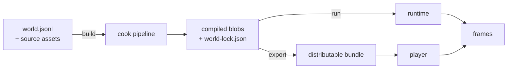
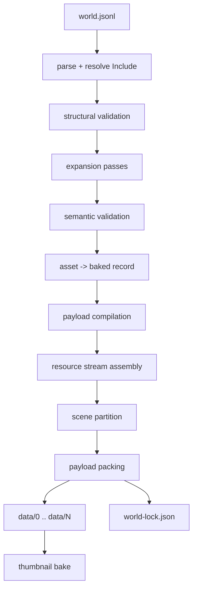
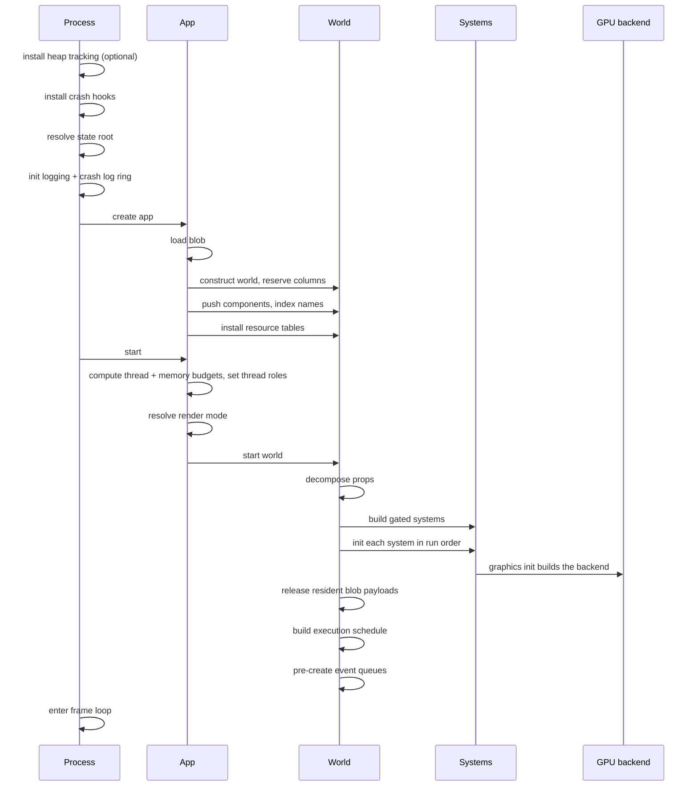
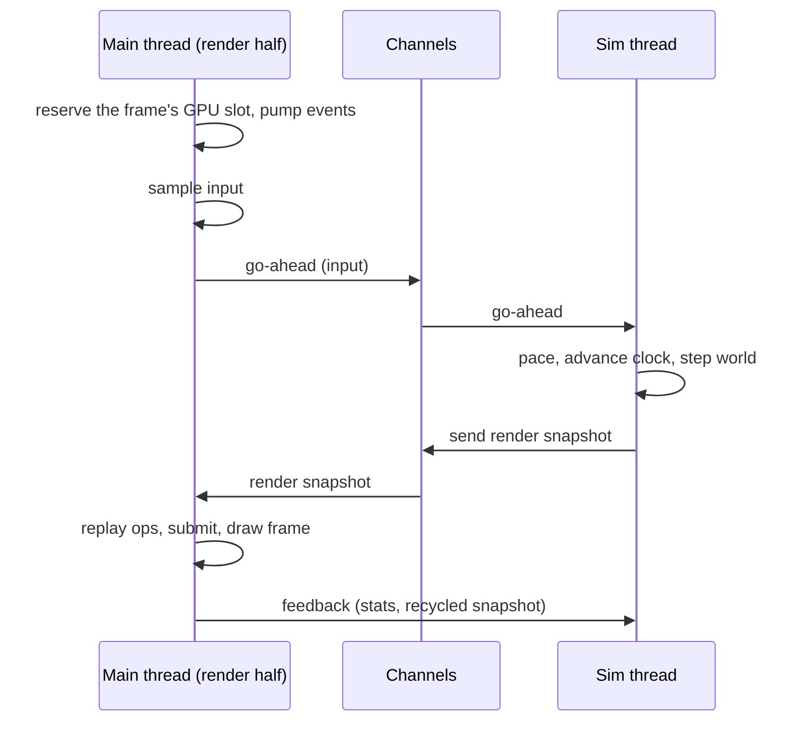
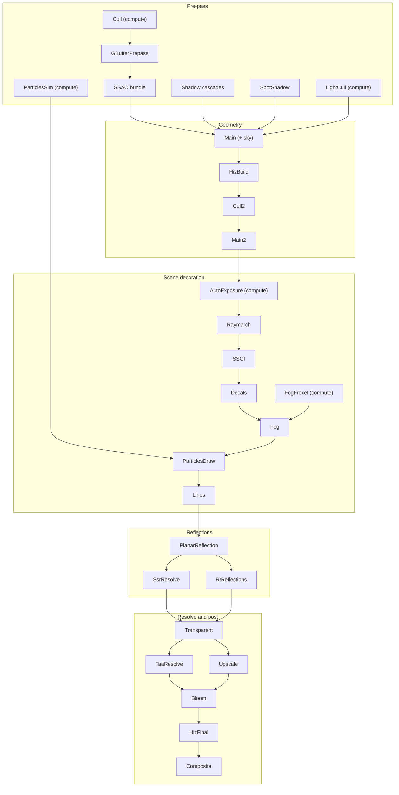
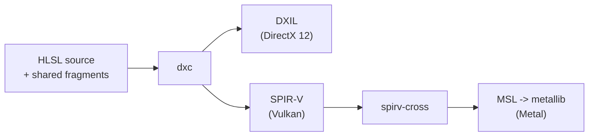

# Technical Specification

This document specifies what Concinnity does and how it does it: the parts of
the engine, the data formats, the execution model, the rendering pipeline and
its techniques, the simulation subsystems, and the contracts between them. It is
the reference for someone who needs to reason about _why_ the engine behaves the
way it does, or who is changing engine internals.

The specification is written independently of the implementation language.
Where a mechanism depends on the language or a specific library, that is called
out in [3.6](#36-implementation-notes).

It deliberately does **not** enumerate asset types or their fields. That is the
[asset reference](../assets/index.md), which is generated from the schema and is
always current. Asset names appear here only where a mechanism depends on them.
Build requirements and per-platform setup are in [building.md](building.md).

**Status.** The engine is pre-1.0. Formats described here are regenerated by
every build and carry no backward-compatibility guarantee. Where a mechanism is
implemented on some rendering backends and not others, that is stated inline.

## Contents

1. [Overview](#1-overview)
2. [Design principles](#2-design-principles)
3. [Engine architecture](#3-engine-architecture)
4. [Data model](#4-data-model)
5. [Authoring format](#5-authoring-format)
6. [Cook pipeline](#6-cook-pipeline)
7. [Compiled world format](#7-compiled-world-format)
8. [State tree on disk](#8-state-tree-on-disk)
9. [Start-up sequence](#9-start-up-sequence)
10. [Runtime execution model](#10-runtime-execution-model)
11. [Rendering architecture](#11-rendering-architecture)
12. [Rendering techniques](#12-rendering-techniques)
13. [Shaders](#13-shaders)
14. [Physics](#14-physics)
15. [Animation](#15-animation)
16. [Behaviors and world logic](#16-behaviors-and-world-logic)
17. [Cameras and scenes](#17-cameras-and-scenes)
18. [Audio](#18-audio)
19. [Input](#19-input)
20. [User interface and text](#20-user-interface-and-text)
21. [Streaming and residency](#21-streaming-and-residency)
22. [Memory management](#22-memory-management)
23. [Concurrency and threading](#23-concurrency-and-threading)
24. [Error handling](#24-error-handling)
25. [Diagnostics and profiling](#25-diagnostics-and-profiling)
26. [Developer tooling](#26-developer-tooling)
27. [Settings and persistence](#27-settings-and-persistence)
28. [Distribution](#28-distribution)
29. [Embedding](#29-embedding)
30. [Appendix A: render pass catalog](#appendix-a-render-pass-catalog)
31. [Appendix B: glossary](#appendix-b-glossary)

---

## 1. Overview

Concinnity is an asset-driven world engine. A world is a declarative list of
assets describing what exists (cameras, lights, geometry, materials, UI,
behaviors, audio) and the engine runs it. Building an application is mostly a
matter of saying what is in it.

The lifecycle has three phases:



1. **Author.** A world is written as line-oriented JSON (section 5), by hand,
   through the CLI, through the in-engine editor, or programmatically.
2. **Cook.** The build expands, validates, and compiles the world and every
   source file it references into binary blobs (sections 6 and 7).
3. **Run.** The runtime loads the blobs, constructs the systems the content
   implies, and steps them in a fixed-timestep loop while a GPU backend renders
   each frame (sections 9 to 21).

A development session can skip the on-disk blobs: `cn debug` and `cn editor`
cook the world in memory and run it directly.

---

## 2. Design principles

These constraints explain most of the structure that follows.

**Asset-driven, not script-driven.** There is no embedded scripting language and
no user-supplied bytecode. Runtime behavior emerges from asset composition: a
`Behavior` asset is a compiled tree of typed nodes over typed state, not a
program interpreted from source. The entire runtime surface is therefore
knowable at build time, which is what makes validation, system gating, and
ahead-of-time compilation possible.

**Cook once, play many.** Everything expensive happens in the cook: source
imports, mesh compilation and decimation, texture encoding, shader compilation,
image-based-lighting convolution, font rasterization. The runtime loads compiled
payloads and uploads them. No asset compiler ships in the player.

**Closed-world storage.** The set of engine component types is fixed when the
engine is compiled. An application may declare additional runtime-only types
beside them (section 4.1), but there is no open-world insertion of arbitrary
types at runtime. This buys dense storage, a bitmask scheduler, and exhaustive
dispatch.

**Gated systems.** No world declares a system. Each engine system has a _gate_
that inspects world content and returns a constructed system or nothing. A world
with no audio content opens no audio device; a world with no physics content
builds no physics simulation. A system written outside the engine is registered
on the world instead, naming the tick _phase_ it runs in.

**One-way dependencies.** The engine's parts form a directed acyclic graph. The
runtime vocabulary knows nothing about file paths; the compiled-format code
performs no I/O; the cook is never linked into a shipped player.

**Platform code stays behind a facade.** Metal, DirectX 12, and Vulkan live
behind one backend interface, with exactly one compiled into a build. Nothing
above that boundary names a concrete backend type, and vendor SDKs (upscalers,
ray tracing extensions) are confined to the backends that use them.

**Untrusted input is decoded defensively.** Compiled payloads and
artist-supplied source files are bytes the process did not produce. Their
decoders use bounds-checked readers and checked size arithmetic, so a truncated
or hostile file is an error, not a crash or an out-of-bounds read.

**Determinism where it is cheap.** Simulation runs on a fixed tick; parallel and
serial schedules must produce identical world state; physics, particles, and
camera tracks are bit-identical across runs given a fixed frame rate.

---

## 3. Engine architecture

### 3.1 Parts

The engine is divided by job, so that each part's dependencies match what it
does and a shipped player carries none of the build machinery.

| Part                | Responsibility                                                                                                                                                                           |
| ------------------- | ---------------------------------------------------------------------------------------------------------------------------------------------------------------------------------------- |
| **Core**            | The runtime vocabulary and the CPU compute over it: components, entity storage, scheduling, the compiled-world format, render preparation and the render graph, physics, behaviors, animation math, bake algorithms. Platform-independent, needs no operating system. |
| **Host**            | What the engine needs from the machine it runs on: the state tree and its paths, the blob store, threads and their priorities, process memory queries.                                 |
| **Engine runtime**  | The application loop and the systems that need an operating system: the renderer driver, audio, input, UI interaction, HUDs, settings, streaming, story playback.                     |
| **Device**          | The hardware-facing layer: the Metal, DirectX 12, and Vulkan backends, windowing, presentation, upscaler SDK integration, and GPU memory allocation.                                   |
| **Shader toolchain** | Compiles the engine's single-source HLSL into each backend's format. Used at engine build time, by the renderer for hot reload, and by the cook for world shaders.                     |
| **Cook**            | The build side: parsing, expansion, validation, source import, payload compilation, packing, thumbnail baking.                                                                         |
| **Developer tooling** | Everything the developer CLI does: project scaffolding, build orchestration, the debug server, the in-engine editor, export packaging, documentation generation.                    |
| **Embedding layer** | A C ABI through which a host application drives a world inside its own view (section 29).                                                                                              |

The public framework is one library facade over these parts. It is tiered:

| Tier          | Contents                                                                                                      |
| ------------- | ------------------------------------------------------------------------------------------------------------- |
| Minimal       | The asset vocabulary, a `World` to build from it, and a headless app that steps it on a virtual fixed clock. No operating system, no GPU. |
| Standard      | The full runtime: windowing, the native render backend, audio, input, streaming.                              |
| Cook          | Adds in-process cooking, so a host can build a world from authored entries without the CLI.                   |
| Editor        | Adds the developer CLI and the editor.                                                                        |

### 3.2 Products

| Product                       | Purpose                                                                                                                                       |
| ----------------------------- | --------------------------------------------------------------------------------------------------------------------------------------------- |
| `concinnity` (alias `cn`)     | Developer CLI: `init`, `new`, `build`, `run`, `debug`, `editor`, `add`, `rm`, `list`, `explain`, `test`, `export`, `docs`, `mcp`, `version`. |
| `concinnity-run`              | The shipped player. Loads compiled blobs relative to its own executable and plays them. No debug server, no compiler, no editor.              |
| Library                       | The framework facade, for applications that construct and run worlds in code.                                                                 |
| C library                     | Static and dynamic builds of the embedding layer, with a generated header.                                                                    |

`cn run` and the player drive the same loop; they differ in where the state root
is anchored and how a missing world is reported. `cn debug` cooks a world in
memory and serves a localhost inspection endpoint; `cn editor` does the same and
overlays the in-engine editor. Neither path exists in a shipped player.

### 3.3 Platforms and backends

| Platform | Default backend | Alternatives                                   | Windowing                         |
| -------- | --------------- | ---------------------------------------------- | --------------------------------- |
| macOS    | Metal           | Vulkan over a portability driver (testing only) | AppKit                            |
| Windows  | DirectX 12      | Vulkan                                         | Win32                             |
| Linux    | Vulkan          | none                                           | GLFW (X11 and Wayland)            |
| iOS      | Metal           | none                                           | Host-owned view through the C ABI |

Exactly one backend is compiled into a build. A build with no backend runs a
world with nothing to draw, or one that declares `AppConfig.headless`, and
refuses any other. DirectX 12 can fall back to the WARP software adapter.

### 3.4 Layering rules

- Core performs no I/O and names no platform API. Its compiled-format code is a
  pure bytes-to-metadata transform; callers own reading and writing.
- The cook carries no backend selection and no native GPU dependency, so it runs
  on a build host with no GPU.
- The runtime systems communicate only through the world (section 10.5). The
  render path consumes an owned snapshot and cannot read live world state
  (section 11.1).
- Shared CPU/GPU data structures have one definition per side and a test that
  asserts their sizes and field offsets agree.

### 3.5 Execution phases

| Phase   | Where it runs                       | Inputs                         | Outputs                                     |
| ------- | ----------------------------------- | ------------------------------ | ------------------------------------------- |
| Cook    | Developer machine or build host     | `world.jsonl`, source files    | `data/` blobs, `world-lock.json`, caches    |
| Run     | Developer machine or end-user device | Blobs (or an in-memory cook)  | Frames, audio, saves, settings, crash reports |
| Export  | Developer machine                   | A cooked world, a built player | A platform bundle                           |

### 3.6 Implementation notes

- The engine is written in **Rust**. Core is written without the standard
  library (allocation only), which is what makes the minimal tier portable.
- Engine shaders are written once in **HLSL** and compiled with **dxc** to DXIL
  and SPIR-V; **spirv-cross** translates SPIR-V to MSL for Metal (section 13).
- Physics, the behavior VM, the render graph, the streaming policy, and the
  compiled-world format are the engine's own; none is a third-party library.
- Third-party components are used for audio mixing and output, gamepad input,
  image and audio decoding, font rasterization, and the vendor upscaler SDKs
  (FidelityFX, NVIDIA NGX, Intel XeSS, MetalFX).
- Logging uses a structured logging layer whose filter can be set from the
  standard environment variable of the logging ecosystem; it defaults to `info`
  in debug builds and `warn` in release builds.

---

## 4. Data model

### 4.1 Assets, components, and resources

Three vocabularies exist and are easy to confuse.

**Asset.** What an author declares in `world.jsonl`: a `["Type", {args}]` entry
whose args may carry a `$id` other entries can name it by. This is the public
schema, documented in the [asset reference](../assets/index.md).

**Component.** The runtime form of an asset that lives on an entity. Every engine
component type is registered once, in a single list, and its position in that
list is its discriminant: an 8-bit value that is both the blob tag and the
in-memory component id. It is _not_ a stable on-disk contract; reordering the
list changes every tag, which is safe only because every cook regenerates the
blob.

**Resource asset.** A compiled artifact addressed by a dense per-kind handle
rather than by entity: meshes, textures, materials, fonts, audio clips,
cubemaps, environment maps, color lookup tables, skinned meshes. These are
installed at load into per-kind tables that systems index by handle.

Some registered types never reach the blob in authored form:

- **Runtime-only** components are produced by systems and never authored
  (`SkeletonPose`, `FrameInput`).
- **Build-only** assets are authoring macros that expand away during the cook
  (`Include`, `SceneImport`, `StoryImport`, `CameraShot`, `LightRig`,
  `MaterialPalette`, `Prefab`, `CharacterModel`, `MainMenu`, `OptionSelect`,
  `Slider`, `Panel`).

An application may declare its own component types beside the engine's. They are
numbered from the first discriminant the engine does not use and get storage
like any other, but have no authoring name and no blob record: they are seeded
by application code. The component bitmask is 128 bits wide, which bounds the
engine and application sets together.

### 4.2 Identity

| Identity           | Meaning                                                                                                                                                       |
| ------------------ | ------------------------------------------------------------------------------------------------------------------------------------------------------------- |
| Asset id           | An asset's position in the expanded world, a dense 32-bit integer. The cook records each position's handle (its `$id`, or `<Type>#<ordinal>` when anonymous). |
| Typed reference    | A reference to another asset of a declared type. Authored as a `$id` string, validated against the target type and resolved to an asset id during the cook.   |
| Resource handle    | Dense index into the matching per-kind resource table.                                                                                                        |
| Entity             | Generational id minted when a component row is pushed.                                                                                                        |
| Payload locator    | `(blob_index: u32, offset: u64, len: u64)`: where a compiled payload lives.                                                                                   |

Names exist for authoring and diagnostics. By the time a frame is drawn, every
reference is a dense integer; the runtime never interns strings.

### 4.3 Entity storage

Storage is one column per component type. A column holds:

- the component values, densely packed;
- a row-aligned entity id per row;
- a row-aligned change tick per row;
- four column-level stamps.

```
Column<Transform>
  data      [ T0 ][ T1 ][ T2 ][ T3 ]
  entities  [ e7 ][ e2 ][ e9 ][ e4 ]
  ticks     [ 41 ][ 41 ][ 58 ][ 12 ]
  stamps    { changed, added, bulk, structural }
```

| Stamp        | Set when                                                                  |
| ------------ | ------------------------------------------------------------------------- |
| `changed`    | Any write of any kind. Drives whole-column change detection.              |
| `added`      | The last row was appended.                                                |
| `bulk`       | Whole-column mutable access was taken; every row must be assumed written. |
| `structural` | A row was added or removed; row positions and membership moved.           |

A consumer that tracks individual rows reads `bulk` and `structural` to decide
whether its per-row stamps still describe reality. Ticks are 32-bit and are
pulled forward when they fall more than half the range behind, so wraparound
never makes a stale row look fresh.

**Join index.** A side table maps an entity to its row in each column,
maintained by every structural edit. Removal is swap-remove, so the row moved
into the freed slot has its recorded position patched.

**Resources** are singleton values keyed by type, used for per-frame protocol
between systems (section 10.5).

**Events** are double-buffered queues with per-reader cursors. An event stays
readable for two update cycles, so every reader that runs after the writer sees
it, and each reader sees each event exactly once. This makes several system
couplings order-robust rather than order-critical.

**Hierarchy.** Entities may be parented. Transform propagation composes local
transforms down the hierarchy each tick, and despawning an entity removes its
whole subtree.

---

## 5. Authoring format

### 5.1 world.jsonl

A world is a JSONL file: one entry per line, each declaring one asset. An entry
is a JSON array of two columns, the asset's type and its args.

```json
["GraphicsConfig",{"background":{"color":[0.5,0.75,1.0,1.0]},"shadows":{"map_size":2048}}]
["Camera3D",{"fov_y_degrees":75.0,"position":[0.0,4.0,22.0]}]
["Texture",{"$id":"tex_stone","generator":"stone","resolution":256}]
["Material",{"$id":"mat_stone","albedo":"tex_stone","roughness":0.88}]
["Scene",{}]
```

| Column | Required | Meaning                                                                                 |
| ------ | :------: | --------------------------------------------------------------------------------------- |
| type   |   yes    | Registered asset type name, a string.                                                   |
| args   |    no    | The asset's public JSON schema, an object. Missing fields take their declared defaults. |

`["Scene"]` reads as `["Scene",{}]`; the tools always write both columns, one
compact entry per line. A line that is a JSON object, or any other shape, is an
error naming the line. Blank lines and lines starting with `//` are skipped.

**Identity.** `"$id"` inside `args` declares an entry's identity: a non-empty
string, unique within the world, and not shaped like an anonymous handle
(`<Type>#<digits>`). It is the only `$` key an `args` object accepts, and it is
checked before any schema reads the args, so a misspelled key is an error rather
than an asset that silently has no identity.

An entry without a `$id` is anonymous, which is the common case. Nothing can
reference it, and wherever a handle must be printed or typed (the CLI, the lock
file, the debug protocol, the editor) it is addressed as `<Type>#<ordinal>`, its
position among the anonymous entries of its type (`Prop#3`). A label is stable
within a build and moves when an anonymous entry of the same type is added or
removed before it. An anonymous build-only entry expands under its label, so its
generated assets are named `MainMenu#0_title` and so on.

Line-oriented JSON is deliberate: it diffs cleanly, appends cheaply, and makes
tooling (`cn add`, `cn rm`, the editor's save-back) a line edit rather than a
document rewrite.

### 5.2 Includes

`Include` stands for the entries of another world file:

```json
["Include",{"path":"lighting.jsonl"}]
```

The included file is written like a world file and may include others. `path`
resolves relative to the including file, and a cycle is an error. Includes
resolve straight after parsing, before labeling, validation, and expansion, so
an included entry is indistinguishable from an inline one: it counts toward the
`<Type>#<ordinal>` labels where it lands, and its `$id` must be unique across the
whole world. `Include` takes no `$id`.

The editor shows included entries in place and read-only; a save writes only the
world file itself, `Include` line included.

### 5.3 References

An asset refers to another by its `$id`, as a plain string. The schema records
which fields are references and what type they must resolve to, so a dangling,
empty, or mistyped reference is a cook error naming the field. References
resolve against declared ids only; an anonymous asset's label names it to a tool,
never to another entry. No name lookup happens at runtime except through the
explicit spawn-by-name path.

### 5.4 Programmatic authoring

Hosts and tools can construct the same entries through a typed builder
vocabulary instead of writing JSON, and with the cook tier can build and run a
world without touching disk. A world can also be assembled directly from runtime
components in code, with no cook at all; such a world is limited to what needs
no compiled payload (computable geometry and textures, UI, behaviors).

---

## 6. Cook pipeline

The **cook** turns an authored world and its source files into blobs. It has a
front half (load, expand, validate) and a back half (compile, pack, write).
`cn build` runs it; `cn debug`, `cn editor`, and `cn export` run it too.



### 6.1 Front half

**Parse and structural validation.** Every line must be valid JSON with a known
type, an object `args`, and at most one well-formed `$id`. Duplicate ids are
rejected. Each anonymous entry is given its `<Type>#<ordinal>` label as its id so
every later pass addresses entries one way.

**Expansion.** A fixed, ordered sequence of passes rewrites the world. Order
matters because later passes must see what earlier passes produced:

| Order | Pass                 | Produces                                                              |
| ----- | -------------------- | --------------------------------------------------------------------- |
| 1     | Scene imports        | Materials, meshes, props, a framed camera, from a `.glb` / `.fbx`.    |
| 2     | Stories              | Screens, text labels, hit regions from a Markdown story graph.        |
| 3     | Camera shots         | Camera presets applied to scenes.                                     |
| 4     | Light rigs           | Directional, point, and spot light sets.                              |
| 5     | Material palettes    | Named material groups.                                                |
| 6     | Prefabs              | Instantiated prop templates.                                          |
| 7     | Room textures        | Per-surface texture assignment.                                       |
| 8     | Companions (round 1) | The window and shader stack implied by everything above.              |
| 9     | AppConfig            | World name and window title for distribution.                         |
| 10    | Engine defaults      | Main menu, HUDs, loading overlay, font, for a rendering world.        |
| 11    | Menus                | Screens, sprites, labels, hit regions, key bindings.                  |
| 12    | Option selects       | Settings rows to their primitives.                                    |
| 13    | Sliders              | Continuous settings rows to their primitives.                         |
| 14    | Panels               | Background sprite plus title label.                                   |
| 15    | Companions (round 2) | Companions for everything rounds 9-14 added. Idempotent over round 1. |

Two properties govern expansion:

- **Injection is visible.** Every asset the cook adds without a `world.jsonl`
  line is recorded in `world-lock.json` with its full args, so it can be copied
  into the world verbatim as an override. `EngineDefaults` flags switch
  individual injected defaults off.
- **Authored wins.** If the world declares an asset with the same `$id` as one a
  pass would generate, the authored entry shadows it. Same id and same type is a
  patch-merge with the author's fields winning; same id and different type is a
  hard error. Shadowing is recorded in the lock file.

**Semantic validation.** Runs on the expanded world: cross-references resolve,
singleton constraints hold, per-type validators pass, and arguments are in
range. Every error is collected and reported together. `cn test` runs the front
half alone.

### 6.2 Back half

**Asset resolution.** Each expanded asset becomes a _baked record_: the
serialized runtime component, its discriminant, its asset id, and a payload
locator if it has one. The asset-to-component translation happens here, so the
runtime never performs it.

**Payload compilation.**

| Asset kind                | Compilation                                                                                                              |
| ------------------------- | ------------------------------------------------------------------------------------------------------------------------ |
| Mesh / model              | Import (glTF, GLB, FBX, OBJ), tangent generation, QEM-decimated LOD chain, index narrowing.                              |
| Procedural mesh           | Generator evaluation (room, box, plane, cylinder, sphere, water grid, profile extrusion), LODs.                           |
| Terrain                   | Height grid from generated noise or a decoded heightmap texture, plus each grass layer's decoded density mask.           |
| Skinned mesh              | Skin weights, bind pose, sparse morph targets, root-motion track extraction, LOD alternates, character capsule.          |
| Character model           | Validation against its schema, synthesized shape targets, optional shape bake into the mesh.                             |
| Texture                   | Decode (PNG, JPEG, BMP, TGA, GIF, DDS, KTX2, HDR) or procedural generation, mip generation, block compression.           |
| Cubemap / environment map | Equirectangular-to-cube projection, irradiance and GGX prefilter convolution, or procedural sky and star fields.          |
| Color LUT                 | `.cube` parse into a 3D lookup payload.                                                                                  |
| Font                      | Signed-distance-field glyph atlas rasterization with real metrics.                                                       |
| Audio clip                | Decode and re-encode into the runtime clip payload.                                                                      |
| Shader / SDF volume       | Splicing of the world's HLSL hooks into engine templates and compilation for the target backend (section 13.3).          |
| Voxel chunk               | Palette resolution and hidden-face meshing.                                                                              |

**Scene partition.** Content reachable only from one scene is grouped into that
scene's _scene group_. Content shared between scenes, or used outside any scene,
belongs to no group and loads with the world. Groups let a multi-scene world
defer decoding and residency until a scene is pinned (section 21.4).

**Packing.** Payloads are appended into blob images under a size ceiling (1 GiB
by default); payloads that do not fit spill into overflow blobs. Each payload's
final locator is written back into its record. Per-scene payloads are packed
after the global set.

**Cook cache.** Compiled payloads are memoized in the build cache segment
(section 8.2) keyed by a digest of their args and source files, so an unchanged
source is not recompiled. A cook reports how many payloads were reused versus
compiled.

**Thumbnail bake.** A disk build closes by rendering an asset thumbnail set with
a CPU rasterizer, for the editor's content browser. A thumbnail failure never
fails a cook that produced valid blobs.

### 6.3 world-lock.json

Written beside the blobs. Provenance metadata, not part of the container format.

```json
{
  "engine_version": "0.19.0",
  "built_at": "2026-10-09T21:13:39.337773Z",
  "blobs": [
    { "path": ".concinnity/data/0", "checksum": "f4f8...", "payload_bytes": 42352312 }
  ],
  "assets": [
    { "name": "gfx", "id": 0, "kind": "Component", "discriminant": 1, "args_hash": "6d2e...", "payload_blob": null }
  ],
  "resources": [],
  "injected": [],
  "shadowed": []
}
```

| Field            | Purpose                                                                              |
| ---------------- | ------------------------------------------------------------------------------------ |
| `engine_version` | Injected defaults come from the engine, so their content can change across versions. |
| `blobs`          | Per-blob path, SHA-256, and payload byte count.                                      |
| `assets`         | Every asset under its handle, with its id, discriminant, and args hash.              |
| `resources`      | Assets compiled into the resource stream rather than the record table.               |
| `injected`       | Everything the cook added with no authored line, with full args.                     |
| `shadowed`       | Generated assets the world declared its own copy of, with the pre-merge args.        |

The recorded ids let a process that loads pre-cooked blobs without an in-process
cook (the editor booting cold) rebuild the handle table exactly as the cook
recorded it.

---

## 7. Compiled world format

The container format is a pure contract: record schema, header constants, and
bytes-to-metadata transforms. It performs no I/O and holds no residency policy.

### 7.1 Image layout

```
+----------------------------------------------------------------+
| HEADER (16 bytes, fixed)                                       |
|  0..4    magic          "CNB\0"                                |
|  4..8    schema hash    u32 LE, compatibility guard            |
|  8..16   meta_len       u64 LE, byte length of the meta block  |
+----------------------------------------------------------------+
| METADATA BLOCK (meta_len bytes)                                |
|  serialized world metadata (7.3)                               |
+----------------------------------------------------------------+
| PAYLOAD SECTION (to end of file)                               |
|  raw compiled payload bytes, addressed by payload locators     |
+----------------------------------------------------------------+
```

The payload section always begins at `16 + meta_len`, so a reader holding only
the first 16 bytes can turn a locator's offset into an absolute file offset
without loading the image. Disk-backed streaming relies on this.

The magic belongs to the metadata kind: `CNB\0` is a cooked world, `CNC\0` a
cache segment (section 8.2). A container of one kind can never be read as
another, and each kind defines the header's second word: a schema hash for a
world, an index layout version for a cache segment.

The schema hash is derived at engine compile time from the record schema. An
image whose hash does not match the running binary's is rejected with a
distinct error. Because a cook always regenerates the blob, the check exists to
catch a stale artifact, not to support migration.

### 7.2 Multiple blobs

Blob 0 is the primary blob. It holds the full metadata block and may hold
payload bytes for assets packed before the size ceiling. Overflow payloads spill
into blobs 1, 2, ... All blobs share the header format; only blob 0 carries
non-empty metadata. Parsing an overflow blob's payload section is lenient: an
image too short to hold a header, or one whose header points past its end,
yields an empty section.

### 7.3 Metadata block

The metadata is serialized in the postcard wire format: compact, positional,
and not self-describing. That is correct precisely because the blob is
regenerated by every cook. (Settings and saves, which persist across builds, use
a self-describing format; see section 27.)

| Field          | Contents                                                                 |
| -------------- | ------------------------------------------------------------------------ |
| Records        | The component stream: one baked record per component asset.              |
| Resources      | The resource stream: one record per resource asset.                      |
| Manifest       | A verified summary of the world's shape.                                 |
| Scene groups   | Per-scene exclusively-owned content, in scene declaration order.         |
| Mesh bounds    | Baked geometry summaries keyed by mesh-source handle.                    |

**Component record.**

| Field         | Type                     | Meaning                                                    |
| ------------- | ------------------------ | ---------------------------------------------------------- |
| name          | optional asset id        | Absent for unnamed runtime-only records.                   |
| kind          | enum                     | Component.                                                 |
| discriminant  | u8                       | Registry position; selects the component type.             |
| args bytes    | byte array               | The serialized runtime component, not the authored args.   |
| payload       | optional payload locator | Compiled data, when the asset has any.                     |

Every record is _baked_: the asset-to-component translation already ran. The
blob carries only components; systems are constructed at runtime from world
content and never serialized.

**Resource record.**

| Field         | Type                     | Meaning                                               |
| ------------- | ------------------------ | ----------------------------------------------------- |
| resource kind | u8                       | Selects the per-kind table.                           |
| handle        | u32                      | Dense index within that kind, equal to its position.  |
| payload       | optional payload locator | Payload and hybrid kinds.                             |
| data bytes    | byte array               | Data and hybrid kinds.                                |

Meshes, textures, and audio clips carry payloads; a baked material carries its
runtime bytes inline. A hybrid kind carries both: a skinned mesh's geometry
payload beside its baked placement, materials, and capsule, and an environment
map's baked lighting beside the runtime fields the renderer reads, so editing
those fields never re-bakes the payload.

Resource kind values are pinned by test, because a reorder would silently re-key
every table:

| Kind             | Value |
| ---------------- | ----- |
| `Mesh`           | 0     |
| `Texture`        | 1     |
| `Material`       | 2     |
| `Font`           | 3     |
| `AudioClip`      | 4     |
| `CubemapTexture` | 5     |
| `EnvironmentMap` | 6     |
| `ColorLut`       | 7     |
| `SkinnedMesh`    | 8     |

**Manifest.** Per-type component counts (ascending discriminant, nonzero only)
and the highest blob index. The runtime trusts it: the counts pre-size every
storage column before the bulk load, and the blob index names the overflow
files without scanning either stream. Debug builds re-derive the manifest and
assert it matches.

**Scene group.** A scene's asset id, its exclusively-owned resources as
`(kind, handle)` pairs, and its payload-carrying component records.

**Mesh bounds.** Per mesh-source handle: AABB min and max, vertex count, index
count. Lets the runtime build draw records and size geometry reservations
without decoding the payload. A payload with no bounds record decodes eagerly.

### 7.4 Payload section

The payload section is opaque to the container: a flat byte range that locators
index into. Individual payload formats are owned by their decoders and are all
tagged and length-prefixed:

| Payload              | Tag    | Shape                                                            |
| -------------------- | ------ | ---------------------------------------------------------------- |
| Texture              | `TEX2` | Format, dimensions, mip chain.                                   |
| Skinned mesh         | `SKMV` | Vertex count, skinned vertices, then optional tagged trailers.   |
| Morph targets        | `MRPH` | Target count, sparse per-target deltas. Skinned-mesh trailer.    |
| LOD alternates       | `LODS` | Level count, per-level index ranges. Mesh trailer.               |
| Terrain              | `TRRN` | Grid resolution, height samples, then one optional mask a layer. |

Every decoder reads through a bounds-checked cursor, and size arithmetic that
could overflow before being compared against a buffer length goes through
checked helpers (section 24.1).

### 7.5 Format invariants

1. The header is exactly 16 bytes and the payload section begins at
   `16 + meta_len`.
2. Only blob 0 carries non-empty metadata.
3. Every payload locator references a blob index at or below the manifest's
   highest blob index.
4. A resource record's handle equals its position within its kind.
5. The manifest is a pure function of the two record streams.
6. Reading is total: every malformed image produces a typed error, never a
   crash.

---

## 8. State tree on disk

Everything the engine writes for a project lives under one state directory.

```
<state root>/
|-- data/            compiled blobs (0, 1, 2, ...)        read-only at runtime
|-- world-lock.json  build provenance record (6.3)        cook only
|-- cache/           regenerable, deletable at any time   see 8.2
|   |-- 0            runtime cache segment                runtime-writable
|   `-- 1            build cache segment                  cook only
|-- assets/          source assets                        authored
|-- worlds/          named world files                    authored
|-- saves/           runtime save files                   runtime-writable
|-- preview-saves/   sandboxed saves for preview sessions runtime-writable
|-- crashes/         crash reports and minidumps          runtime-writable
`-- settings         persisted settings (CBOR)            runtime-writable
```

The tree has four roots, and a host that keeps them together gets the layout
above. The **content** root holds what a person authors (`assets/`, `worlds/`);
the **build** root holds what a build produces (`data/`, `world-lock.json`); the
**writable** root holds what a run writes (`saves/`, `settings`, `crashes/`); the
**cache** root holds the regenerable segments. Each of the last three defaults
to the content root and may be split away on its own.

### 8.1 Root resolution

There is no default root, and the engine never reads the environment to find
one. A host installs the state directory before anything reads the tree; until
it does, reads that need it report "no state root" and the caches, settings, and
saves do nothing. A library embedded in someone else's program therefore never
scatters state beside whatever directory it was launched from.

| Host        | Root                                                                                                                                                                                                       |
| ----------- | ---------------------------------------------------------------------------------------------------------------------------------------------------------------------------------------------------------- |
| Development | The CLI roots the project at the directory it was run from, so `assets/` and `worlds/` sit beside the source that authored them, and places the build and writable roots in `.concinnity/` under it. A `world.jsonl` at the project root is used when `worlds/` holds none. |
| Shipped     | The player installs the directory beside its own executable (or `Contents/Resources` inside a macOS bundle).                                                                                               |
| Embedded    | A world loaded from a blob path anchors the tree beside that blob, stepping out of a directory named `data`. A host that names its own directory overrides that.                                          |

A world's `AppConfig.home` overrides where the runtime-writable half goes: an
absolute path verbatim, a relative one against the content root, empty for
"beside the data".

**Read-only install.** When the player cannot write beside its data (for
example under Program Files), only `saves/`, `settings`, `crashes/`, and the
runtime cache segment relocate to a per-user directory: `%LOCALAPPDATA%` on
Windows (falling back to `%APPDATA%`), `~/Library/Application Support` on macOS,
`$XDG_DATA_HOME` or `~/.local/share` elsewhere. The player probes writability at
startup and relocates only when needed; an authored `home` takes precedence.

### 8.2 Cache separation

`cache/` holds only what can be regenerated. A user may delete it at any time and
whatever is missing is recomputed. It is segmented by writer, so two processes
never write one file even when a build runs against a live editor.

**`cache/0`, the runtime segment.** A `CNC\0` container written by the running
application. Its index keys each entry by producer and by the key the entry is
valid for:

- Driver pipeline caches are machine code tied to one GPU and driver; they key on
  the adapter, never ship, and a cache from another adapter is a miss.
- Runtime-compiled shader artifacts key on a digest of everything the compile
  depended on, and the segment names the shader toolchain that produced them, so
  a compiler upgrade discards them. Only shaders no build could enumerate land
  here: an edited shader under hot reload, a program sized to the device below
  the build's ceiling, a world's own distance field.

**`cache/1`, the build segment.** The same container written by the cook: compiled
payloads and scene-import expansions keyed by a digest of their args and source
files, plus the baked thumbnails and a map from asset name to thumbnail key. Its
header carries the identity of the cook executable that wrote it, so a segment an
older binary wrote is dropped whole. The editor stamps its loaded thumbnail set
on the map's digest rather than the file, which every build rewrites.

Each segment is read once, at the first lookup, and written once when the work
producing its entries finishes (renderer init and teardown for `cache/0`; the end
of an expansion, a compile, or the thumbnail bake for `cache/1`). An init that
compiles fifty shaders costs one write, and a crash before it costs a recompute.

The runtime segment is bounded by a budget and kept in memory. The build segment
has no ceiling, so it keeps only its index resident and seeks to the one entry a
lookup wants, and its rewrite streams carried-forward entries straight from the
file it replaces.

---

## 9. Start-up sequence

### 9.1 Overview



### 9.2 Process initialization

**Heap tracking** is optional and installed by the binary, not the library. A
binary without it runs correctly; every reader of heap statistics treats them as
absent, so crash reports ship without heap figures and long-session drift
detection reports nothing.

**Crash hooks** install next: a panic hook that writes a report and chains to
the previously installed hook, plus a native fault handler on macOS and Windows.
The compiled backend is stamped as a crash-report note.

**Logging** installs with a ring-buffer layer so crash reports carry the recent
log lines.

### 9.3 Blob load

1. Read blob 0, validate the magic, schema hash, and metadata length.
2. Decode the metadata block.
3. For each component record: decode the baked bytes into the runtime component,
   attach its payload locator and its name.

Only blob 0's payload section is read into memory. Overflow blobs start unloaded
and are read on first access by a locator, so a large world does not pay the RAM
or I/O cost of every overflow blob at startup.

A load failure is classified before it is reported: _missing data_ when the
primary blob's path does not exist (the cook never ran, or the installation lost
its data folder), _unreadable data_ when the path exists but the load failed (a
truncated file, a schema the binary no longer understands, a failed read). Only
the first is the user's to fix (section 24.3).

### 9.4 World construction

1. **Reserve.** The manifest's per-type counts size every column once, so the
   bulk load never reallocates mid-push.
2. **Push.** Each decoded component is pushed into its column, minting an
   entity. Named components are indexed into a name-to-entity map as they are
   minted.
3. **Publish.** The name index, the scene groups, and the mesh bounds are
   inserted as world resources.
4. **Install resource tables.** The resource stream is loaded into the per-kind
   tables.

### 9.5 Budgets and thread roles

Before systems start, the app computes two budgets and publishes them as
resources.

**Thread budget.** The shared job pool's worker count: `cores - 1` by default,
floored at one, or the world's `AppConfig.job_threads` capped at the core count.
It also carries the frame priority (section 23.2) to the pool and drivers.

**Memory budget.** A soft ceiling on host memory the runtime aims to stay under:
the lesser of 16 GiB and 70% of physical RAM, or an `AppConfig.max_memory_mb`
override capped at 85% of physical RAM. When the RAM query fails, the hard
ceiling (or the bare override) stands.

Budget installation is idempotent: the editor's live rebuild recomputes the same
values and pool sizing does nothing.

### 9.6 Decomposition

A load-time pass gives each `Prop`'s entity the per-instance components it is
composed of: a transform, a mesh or model renderer (a `model` takes precedence
over a `mesh`, encoded as one renderer component or the other), an optional
collider and body, gameplay tags, scene membership, and parent/child links. The
pass then drains the `Prop` column; the entities survive on their per-instance
components, and cross-references between placements resolve through the name
index. The runtime has no `Prop` concept: it is an authoring convenience that
exists only until systems start.

### 9.7 System gating and init

The system table is the single registry _and_ the schedule: table order is run
order. Each entry pairs a system with:

- a **gate** that inspects world content and returns a constructed system or
  nothing;
- a human-readable **present-when** condition, used by documentation and
  `cn list --systems`;
- a **phase**, the band of the tick the entry runs in;
- **after** / **before** ordering edges naming other systems.

Gates construct their system, so every constructor stays cheap and free of side
effects: `cn list` constructs and discards each gated system to report what a
world would build. Device acquisition and payload reads belong in system init.

The phases are `Early`, `Logic`, `Late`, `PreRender`, and `PostRender`, and the
table's entries are in phase order. The tick simulates first and submits its
frame last, so the frame shows everything the tick resolved. A system written outside the engine is registered on
the world naming a phase; within a phase every table entry runs before every
registered system, so a registration never reorders the engine's own tick. A
registered name that repeats a table entry's is refused at start.

Systems are then initialized in run order. Graphics init is by far the largest.

### 9.8 Graphics initialization

Graphics init runs once, on the first tick:

1. **Resolve render settings.** Take each `GraphicsConfig` section's defaults,
   replace every field the world sets, cap the result under the quality ceiling
   (section 12.17), then apply persisted settings and launch options; the
   `ColorLut` strength and `StreamingConfig` join the same snapshot. A field
   the world leaves unset follows the quality tier, and a world with no
   `GraphicsConfig` resolves as one with every field unset.
2. **Drain world content.** Window, graphics settings, meshes, procedural meshes,
   models, placements, shaders, textures, voxel worlds, block types, rooms.
3. **Decode geometry.** Mesh payloads, room geometry, skinned geometry with
   skeletons and morph targets. Mesh sources owned by a non-start scene skip
   decode: their draw records use the baked bounds and the mesh streamer decodes
   them on scene pin.
4. **Decode shaders.** Per-stage compiled payloads for the world's shader
   programs; deferred (non-start-scene) programs record where to re-read their
   container instead.
5. **Decode media.** Texture pool, material table, glyph atlases, environment
   map, color LUT. Deferred texture slots enter the pool as 1x1 placeholders.
6. **Build the draw list.** For each placement, append its geometry to the shared
   vertex and index buffers and record a draw object with its slice offsets,
   model matrix, and material and texture slots. A mesh with no placement gets
   one implicit draw at the origin.
7. **Probe the GPU.** A throwaway device handle classifies the adapter so the
   quality ceiling can shape the targets and pipelines the backend sizes at init.
8. **Construct the backend.** Hand everything above to the compiled backend,
   trimming scene feature requirements a world with no 3D content does not need.
9. **Wire streaming.** Build the texture, mesh, and chunk streamers from world
   content and backend support.
10. **Publish protocol resources.** Frame-rate cap, display modes, HUD
    preferences, settings state, render queues, the slot allocator.

The backend is parked in the world as a resource. Each step takes it and puts it
back, so the backend and the pipeline context are never held together.

### 9.9 Payload release

Once every system has initialized and cached what it keeps, nothing reads
compiled payloads at runtime. World start frees every blob section still
resident. Released sections error on read rather than reloading.

Streaming worlds are the exception: when the blobs are disk-backed, the streamer
re-reads payloads from their files on demand instead of holding RAM copies.

### 9.10 Schedule construction

Access declarations are final only once every system has initialized, so this is
the earliest point the schedule can be derived (section 10.4). Finally, the event
queues systems can touch are pre-created, so no queue map grows mid-tick.

---

## 10. Runtime execution model

### 10.1 Windowed or headless

Whether a run has a window is resolved once, before world start, and published as
the render mode every render-band system is gated on. Four conditions are checked
in order, so the GPU is only probed for a world that would otherwise open a
window:

| #   | Condition                                   | Result             |
| --- | ------------------------------------------- | ------------------ |
| 1   | The world declares `AppConfig.headless`.    | Headless           |
| 2   | The world holds nothing flagged `renders`.  | Headless           |
| 3   | The build compiles no render backend.       | Fails to start     |
| 4   | The GPU probe finds no usable device.       | Fails to start     |
| -   | Otherwise.                                  | Rendered           |

The `renders` flag belongs to the registry, the same flag the cook's companion
pass reads to inject a `Window` (and, through the `Window`, an empty
`GraphicsConfig`), so a cooked world and one assembled in code answer
identically. It marks what draws: geometry, text, sprites, a screen, a window.
A camera, a light, or an unplaced mesh draws nothing by itself.

Content that draws needs a renderer: conditions 3 and 4 refuse the run with an
error naming `AppConfig.headless` rather than running it blind. Condition 4 is
narrow: no adapter or device at all. A GPU that is present and then fails to
build a backend is the same startup failure (section 24.3). `cn list --systems`
applies conditions 1 and 2 only, so the schedule a world implies does not change
with the build host.

### 10.2 The frame loop

Two drivers exist.

**Pipelined (default for a rendering world).** Simulation and rendering run on
separate threads, and each step simulates just before its frame is recorded.



The main thread keeps everything the OS and GPU pin to it: the event pumps, the
backend, frame submission, and swapchain recreation. The sim thread owns the
frame pacer, the fixed-tick clock, and the world step, and produces snapshots.

The step waits for the render half's **go-ahead** before its clock reads the
time. While frames wait on the GPU, the render half reserves the next frame's
GPU slot first (the frames-in-flight wait), samples input, and only then lets
the step go, so the tick reads input taken just before its frame is recorded
rather than input that waited out the GPU. GPU and vsync backpressure land in
the wait for the go-ahead, where the fixed-tick accumulator counts it as
ordinary frame time. While frames do not wait on the GPU there is no wait to
move: the go-ahead comes as soon as a snapshot arrives, and the next step
overlaps that frame's submission. The loop switches after a few frames on the
other side of a 1 ms wait, so one frame across the bound does not flip it.

The snapshot channel is a **rendezvous** (capacity zero). This is load-bearing:

- Exactly one frame is in flight between the halves.
- Every snapshot is consumed exactly once, in order, which the model-push dedupe
  and slot-allocation ops depend on.

The feedback channel returns render stats, op-replay results, and the consumed
snapshot for buffer reuse. A crash on the sim thread is re-raised on
the main thread after the render half drains.

**Serial.** Both halves step on the main thread. This is the editor's mode, the
headless mode, and an escape hatch (`cn run --serial`).

On macOS the loop pumps the Cocoa run loop on the main thread each tick so AppKit
callbacks and drawable presentation fire. In the pipelined driver the render
half's wait for a snapshot is sliced so the run loop keeps draining during a long
simulation frame.

### 10.3 Time

Simulation runs at a fixed 60 Hz tick regardless of frame rate. The accumulator
sits at the app level, after the frame pacer and before the world step:

```
elapsed     = now - last
if !paused: accumulator += max(elapsed, 0)
accumulator = min(accumulator, MAX_TICKS_PER_FRAME * TICK_DT)
ticks       = paused ? 0 : floor(accumulator / TICK_DT)
accumulator -= ticks * TICK_DT
alpha       = clamp(accumulator / TICK_DT, 0, 1)
```

Two resources are published each frame:

| Resource       | Field     | Meaning                                                                                                              |
| -------------- | --------- | -------------------------------------------------------------------------------------------------------------------- |
| Sim timing     | `ticks`   | Fixed steps the simulation systems run this frame.                                                                   |
|                | `tick_dt` | Seconds per step (1/60).                                                                                             |
|                | `alpha`   | Accumulator remainder as a fraction of a tick; blends previous and current simulated state for render transforms.   |
| Frame time     | `dt`      | Real seconds since the previous frame, still measured while the world is paused.                                     |
|                | `elapsed` | Monotonic seconds since the app started.                                                                             |

Presentation systems (animation, cameras, HUDs, fades) accumulate their own
clocks from frame time; simulation systems consume ticks.

**Hitch clamping.** At most 5 ticks run in one frame; accumulated time past that
is dropped, so a long hitch degrades to slow motion instead of a tick spiral.

**Pause.** While a world-pausing screen is open the clock emits zero ticks and
stops accumulating but keeps the remainder, so the frozen frame keeps rendering
the same blend and resuming costs one normal frame.

**Fixed frame rate.** A launch option replaces measured frame time with a fixed
interval, which makes a whole run (including physics, particles, and camera
tracks) bit-identical across launches. Benchmarks and pixel comparisons use it.

When no app publishes timing (a world stepped directly), each step is exactly one
tick with no blending, which makes bare step loops deterministic.

### 10.4 The execution schedule

The schedule is built once per world start and rebuilt only when the system set
changes (a system that reports done is removed).

**Validation.** Each entry's declared `after` / `before` edges are checked
against table order. A contradiction is a startup failure, not a silent reorder.

**Conflict derivation.** Each system declares its access: which components and
resources it reads and writes, and whether it is exclusive. Two systems conflict
on a read-write or write-write overlap, or if either is exclusive. A conflicting
pair keeps its table order, which is what makes the schedule's observable state
identical to a plain serial walk.

**Wave assignment.** Systems are grouped into waves whose members neither
conflict nor have an ordering edge between them. Every predecessor is earlier in
table order, so one pass assigns levels:

```
level[i] = max(level[p] + 1 for p in preds[i])   or 0
```

**Parallelism today.** The tick walks systems in table order; parallelism comes
from systems fanning their own data-parallel work across the shared job pool,
gated by the schedule mode:

| Mode                 | Behavior                                                                                   |
| -------------------- | ------------------------------------------------------------------------------------------ |
| Parallel (default)   | Systems may fan safe internal work across the job pool.                                    |
| Serial               | Every system's work stays on the stepping thread. The determinism oracle and escape hatch. |

Both modes must produce identical world state; a schedule-determinism test is the
gate. The wave structure is derived regardless, because it is also the proof that
the declared accesses are consistent.

### 10.5 Inter-system protocol

Systems do not call each other. They communicate through three mechanisms.

**Resources:** per-frame singletons published by one system and read by others
the same tick. The important ones:

| Resource                | Published by                             | Read by                                         |
| ----------------------- | ---------------------------------------- | ----------------------------------------------- |
| Menu active             | Overlay (first in the schedule)          | Simulation, input, and the draw, the same tick. |
| Sim timing, frame time  | The app clock, before the step           | Physics, behavior, animation, presentation.    |
| Frame-rate cap          | Graphics                                 | The app-level frame pacer.                      |
| Camera-relative view    | Streaming                                | Graphics, for the draw.                         |
| Input mailbox           | The render half's go-ahead (or Graphics) | Input, first in the next tick.                  |
| GPU memory pressure     | Graphics, streaming                      | The streaming back-off valve.                   |
| Render queues           | Graphics init                            | Every op-recording system.                      |
| Pending history reset   | Cameras, scenes, settings, behaviors     | Graphics, to reset temporal history (12.13).    |

**Events:** two-frame-retained queues with per-reader cursors, for couplings
that must survive ordering changes (root motion, physics probes, setting
commands).

**Recorded ops:** the frame's backend effects (section 11.2).

### 10.6 System table

Table order is run order. The rationale for each ordering edge is part of the
registry.

| #   | System              | Phase      | Present when                                                                                                          |
| --- | ------------------- | ---------- | --------------------------------------------------------------------------------------------------------------------- |
| 1   | Overlay             | Early      | The world runs with a window.                                                                                         |
| 2   | Input               | Early      | The world runs with a window.                                                                                         |
| 3   | Sky rotation        | Early      | The world declares a `SkyRotation`.                                                                                   |
| 4   | Planet              | Early      | The world declares a `Planet`.                                                                                        |
| 5   | Behavior            | Logic      | The world declares any `Behavior`.                                                                                    |
| 6   | Physics             | Late       | The world declares a `PhysicsConfig`, `RigidBody`, `PropBody`, or `TriggerVolume`, or a skinned mesh bakes a capsule. |
| 7   | Water spray         | Late       | A `WaterSurface` names a `spray` emitter.                                                                             |
| 8   | First-person camera | Late       | The first controlled `Camera3D` has no follow block.                                                                  |
| 9   | Third-person camera | Late       | The first controlled `Camera3D` has a follow block.                                                                   |
| 10  | Camera track        | Late       | The world declares a `CameraTrack` and the `Camera3D` it drives.                                                      |
| 11  | Animation           | Late       | The world declares any `Animation` or `AnimationGraph`.                                                               |
| 12  | Story               | Late       | The world declares a `Story`.                                                                                         |
| 13  | Audio               | Late       | The world declares any `AudioEmitter`, `AudioCue`, story audio, or a `Behavior` with a sound node.                    |
| 14  | Screenshot          | Late       | The launch has a `--screenshot-at`, or takes the world's shots and the world declares a `Screenshot`.                 |
| 15  | Text input          | Late       | The world declares any `TextInput`.                                                                                   |
| 16  | Stat HUD            | Late       | The world declares a `StatHud`.                                                                                       |
| 17  | Debug HUD           | Late       | The world declares a `DebugHud` and the binary is a debug build or a dev session.                                     |
| 18  | FPS counter         | Late       | The world declares an `FpsCounter`.                                                                                   |
| 19  | Spawn               | PreRender  | The world runs with a window.                                                                                         |
| 20  | Settings            | PreRender  | The world runs with a window.                                                                                         |
| 21  | Streaming           | PreRender  | The world runs with a window.                                                                                         |
| 22  | Loading overlay     | PreRender  | The world declares a `LoadingOverlay`.                                                                                |
| 23  | UI input            | PreRender  | The world declares any `HitRegion`, `Screen`, or `KeyBinding`.                                                        |
| 24  | Graphics            | PostRender | The world runs with a window.                                                                                         |
| 25  | Frame report        | PostRender | The run is benchmarked (`--benchmark`).                                                                               |

Key ordering constraints:

- **Overlay first.** It publishes the menu state that gates simulation, input,
  and the draw this same tick.
- **Sky rotation before graphics.** The rotated celestial frame is ready for the
  draw.
- **Behavior before spawn, settings, story, and audio.** The requests its rules
  emit drain the same tick.
- **Spawn, settings, and streaming before graphics.** A despawn is applied
  before the transform push, a setting change lands for this frame's submit, and
  a chunk world's camera rebase is ready for the draw.
- **Input first, graphics last.** The tick consumes the input sampled before it
  began, and the frame it submits at its end shows that input, the simulation
  and the cameras. Graphics initializes early all the same: its init builds the
  window, the backend and the indexes later inits read.
- **Planet before behavior, spawn, physics, and the cameras.** A move of a
  planet world's simulated frame lands before anything the tick places or
  moves, so a spawn request and its drain share one frame.
- **Streaming after the cameras.** The camera-relative view it publishes is the
  pose this tick's frame draws.
- **Loading overlay after streaming, before UI input.** It reads the residency
  status published this tick, and its screen commands apply the same tick.
- **Physics before the camera controllers.** Physics consumes the camera's
  previous-frame movement intent, a deliberate one-frame-lagged resolution.
- **Cameras and story before audio.** The listener reads the camera, and page
  audio is heard the same tick.
- **Cameras before screenshots.** A shot requested this tick shows the pose the
  cameras and the camera track just set.

Blobs are profile-agnostic (the cook injects a debug HUD into every rendering
world), so the running binary is the one place its own profile is knowable: a
debug build or a dev session activates the debug HUD, a release run leaves it
inert.

Headless worlds use a reduced table of the systems that need no operating system:
sky rotation, behavior, physics, and camera track.

### 10.7 The step

```
step():
  profile.begin_frame()          rotate timing buffers
  update_events()                advance every queue's double buffer
  scratch.reset()                hand the frame arena back
  for each system in order:
      time it
      match step result:
        Continue -> keep
        Done     -> remove the system, mark the schedule stale
        Stop     -> return Stop immediately
  rebuild the schedule if anything was removed
  report scratch overflow
  return Done if no systems remain, else Continue
```

`Done` retires one system and lets the world keep stepping the rest. `Stop` ends
the run. A failed graphics init returns `Stop`, never `Done`, which would leave
the process spinning with no window and no pacing.

### 10.8 Frame pacing

The frame-rate cap is applied at the app level, before the world steps, so no
system pays the sleep inside its own step time.

```
wait_until = previous_deadline if still in the future, else now
next       = wait_until + target_interval
```

When the previous deadline is still ahead, the cap is met exactly with no drift.
When it has passed (an overrunning frame), the deadline resets to now, so a slow
frame never triggers a catch-up burst. A cap change clears the deadline. The cap
is the only limit the pacer applies; a menu view runs at it like any other frame.

---

## 11. Rendering architecture

### 11.1 Extract and submit

Rendering is split into two phases with a hard boundary.

**Extract** reads world state and fills an owned _render snapshot_. This is the
only per-frame world read the renderer performs.

**Submit** consumes the snapshot and drives the backend. It has no access to the
world, so the draw path cannot read live world state by construction.

The snapshot is self-contained, so a frame's draw inputs can outlive the world
access that produced them and cross to the main thread in the pipelined driver.
Its buffers keep their capacity across frames, so steady-state extraction
allocates nothing.

| Snapshot field     | Contents                                                       |
| ------------------ | -------------------------------------------------------------- |
| Frame scalars      | Camera, elapsed time, view mode, show flags, history reset.    |
| UI intents         | Cursor visibility, menu mode, camera capture.                  |
| Ops                | Recorded backend effects (11.2).                               |
| Model pushes       | Changed model matrices.                                        |
| Poses, morphs      | Per-skinned-slot joint matrices and morph weights.             |
| Scene ops          | Fades and visibility changes, in record order.                 |
| Text calls         | Glyph and sprite draws for the overlay.                        |
| Lines              | World-space line segments.                                     |

Variable-length per-slot updates use a span buffer: one flat values buffer plus
`(slot, start, len)` spans, so extraction copies into persistent storage and
submission replays one backend call per span.

### 11.2 Op recording

Systems that need backend effects (spawn slot churn, settings appliers,
streaming uploads) never touch the backend. They record ops with owned payloads,
naming destinations from the engine's slot allocator. Extraction moves the ops
into the snapshot and submission replays them in record order before the draw.

This is what lets spawn, settings, and streaming run on the sim thread while the
backend lives on the main thread. An op the backend refuses comes back one tick
later as a failure entry and is rolled back at the top of the next step.

### 11.3 Submission order

```
1.  replay recorded ops                   spawn slots, settings, uploads
2.  apply UI intents                      cursor, menu mode, camera capture
3.  window closed?                        -> wait idle, Stop
4.  update models                         model matrix pushes
5.  update skinned poses, morph weights   per skinned slot
6.  update skinned models
7.  replay scene ops                      fade, visibility, in record order
8.  update view                           before the draw, so Metal's event
                                          pump inside the draw sees fresh state
9.  draw frame                            the render graph executes
10. on success: reset failure streaks
    on failure: consult the frame policy  (24.4)
```

### 11.4 The render graph

Every backend dispatches its passes through one build-then-execute graph. The
graph owns pass order, barriers, lifetimes, and the description of transient
targets: extent, format, sample count, mip count, and usage are declared once in
the graph, and each backend translates that description into a native
descriptor.

**Construction.** A per-frame input record carries one flag per gated pass,
derived from live backend state and world content. The builder declares passes
with typed read and write edges on resource handles.

**Handles and versions.** A handle pairs a resource id with a version. A write
returns a handle to the post-write version; the old handle still names the
pre-write version. A read-modify-write chain (main writes the HDR target, decals
rewrite it, fog rewrites it again) is therefore an unambiguous DAG.

**Compilation** derives:

- **Execution order:** a topological sort over read-after-write,
  write-after-write, and write-after-read edges, ties broken by declaration
  order. Order is derived, never declared.
- **Barriers:** one per resource state transition. What a state means natively
  follows the usage the resource declares. A resource's _resting_ state between
  frames is declared per resource and per backend (the staggered shadow cascades
  rest sampled because a skipped slice keeps its last depth; main depth is fully
  rewritten and rests discarded), and a frame that ends a resource elsewhere is
  closed by one restoring transition. Where a read run spans two queues, the
  transition is issued by the producer.
- **Transient lifetimes:** the passes that touch each resource, the input to the
  aliasing planner.
- **Queue assignment:** see 11.5.

**Resource origins.** _Imported_ resources are engine-owned and outlive the frame
(the shadow maps, the froxel volume, the Hi-Z pyramid, the particle pools).
_Created_ resources are single-frame transients the aliasing planner may pack
into shared memory. A resource qualifies as transient only if its first touch
fully writes it, no later frame reads it, its whole lifetime is inside the graph,
and no configuration makes it the same GPU object as another graph resource.

**Aliasing.** The planner places each transient in the first compatible slot
whose every member the schedule orders strictly before it, else opens a new
slot; a slot is sized to its largest member. "Strictly before" is the schedule's
happens-before relation over the dependency DAG plus each queue's serial order,
not a pass-index comparison, because with async compute two resources with
disjoint index ranges can be live at once on two queues. Members of a slot agree
on depth-versus-color and sample count.
Pools are built at init while graphs compile per frame, so a grouping decided on
one graph applies to every later one. Three layers keep that sound: the pool
plans against its configuration with every gated pass forced on; a headless
sweep asserts no slot has overlapping members across the reachable input space;
and each executor asserts the same predicate per frame in debug builds.

**Conditional passes** use an invalid-handle sentinel, so call sites stay
branchless: reads and writes of an invalid handle are no-ops.

**Menu masking.** When an opaque menu backdrop hides the scene, the builder forces
every gated world pass off, collapsing the graph to a bare-clear main pass and the
composite.

### 11.5 Queues and async compute

The schedule plans two queues, graphics and async compute. A compute pass moves
to the async queue when some render pass is neither its ancestor nor its
descendant and every transition it takes part in is ordered by a data
dependency; cross-queue signal and wait pairs come from the same edges. Particle
simulation is declared early so it depends on nothing in the frame and can
overlap the whole raster front; cull, light cull, the froxel volume, and the
terminal Hi-Z build also land on the async queue.

Metal submits the two queues for real, with one event per queue and a full
barrier in both directions at the frame boundary. Vulkan and DirectX 12 flatten
the plan into one serial order on one queue.

Because async compute makes the schedule partially ordered, transient aliasing
uses the happens-before relation rather than pass order (11.4).

### 11.6 Recording

Non-composite passes are recorded in parallel on job-pool workers, each into its
own command buffer, and submitted in graph order. Each backend minimizes
per-frame host work: argument buffers and descriptor tables are rewritten only
when their contents change, per-frame uploads ride rings rather than fresh
allocations, and barriers are batched per pass.

### 11.7 Frame structure

A fully-featured frame, in dependency order:



The full catalog is [Appendix A](#appendix-a-render-pass-catalog). Notable
structural decisions:

**The HDR chain.** A 16-bit float HDR target is written by the main pass and then
read-modify-written by each decoration pass in turn (raymarch, SSGI, decals, fog,
particles, lines). Auto-exposure is pinned before the first decoration by a
write-after-read edge, so it always meters the undecorated scene.

**Two-pass occlusion.** Phase 1 culls against the previous frame's Hi-Z pyramid
and draws; a mid-frame compute pass rebuilds the pyramid from phase 1's depth;
phase 2 re-tests the objects phase 1 marked occluded and draws the disoccluded
survivors, depth-compositing with phase 1. Instanced and skinned geometry is not
Hi-Z tested, so it draws fully in phase 1.

**Terminal Hi-Z build.** The last compute pass reduces the frame's final depth
into the pyramid the next frame's phase-1 cull tests against. It is a graph node,
not an action after the graph, so main depth stays live to the end of the frame
and cannot be aliased away while the reduction reads it.

**Unified G-buffer pre-pass.** One jittered traversal writes view-space normal
and linear depth, perceptual roughness, and screen-space motion into an MRT, plus
its own depth. Each attachment is its own graph resource because their consumers
differ: ambient occlusion, SSGI, and reflections read normal and depth; only
reflections read roughness; only temporal passes read motion; only upscalers read
the pre-pass depth.

**Sky inside the opaque passes.** The sky is not a pass of its own; it is drawn
last inside every pass that renders the opaque scene (12.8).

**Reflections are exclusive.** Ray-traced and screen-space reflections occupy the
same slot; when ray tracing is live the builder inserts it and omits SSR.

**Upscaling replaces TAA.** A temporal upscaler performs temporal accumulation
itself, so inserting both would accumulate twice.

### 11.8 Backend variance

All three backends share one graph builder and one set of graph inputs. A
feature that is unavailable (unsupported GPU, not requested by the world, or a
pipeline that was not built) keeps its input flag false, and its node never
appears in that frame's graph. Feature gating is per frame and per device, not
per backend.

| Concern                    | Metal                                          | DirectX 12                                            | Vulkan                                                |
| -------------------------- | ---------------------------------------------- | ----------------------------------------------------- | ----------------------------------------------------- |
| Shader artifact            | MSL, built into metallibs                       | DXIL                                                  | SPIR-V                                                |
| Built-in shaders           | Compiled at engine build time, embedded        | Compiled at engine build time, embedded              | Compiled at engine build time, embedded              |
| Driver pipeline cache      | OS-maintained per-app cache                    | Pipeline library, persisted per adapter               | Pipeline cache, persisted per adapter                 |
| Graph barriers             | Mostly implicit; hazard-tracked heaps          | Explicit resource barriers from graph state           | Explicit pipeline barriers from graph state           |
| Queues                     | Graphics + async compute                       | One queue                                             | One queue                                             |
| Transient pool backing     | One hazard-tracked placement heap per slot     | One heap per slot, single-buffered                    | One allocation per slot per frame in flight           |
| Indirect draws             | Status buffer encoded into an indirect command buffer | Execute-indirect with a per-draw root constant | Indexed indirect, object id in the first instance    |
| Hi-Z build                 | Per-mip chain                                  | Single-pass downsampler                               | Single-pass downsampler                               |
| Ray tracing                | Metal intersection queries                     | DXR inline ray queries (SM 6.5)                       | Ray query + acceleration structures                   |
| Temporal upscaling         | MetalFX                                        | DLSS, XeSS, FSR 3                                     | DLSS, XeSS, FSR 3                                     |
| HDR output                 | scRGB and PQ                                   | scRGB and PQ                                          | Extended linear only                                  |
| Per-pass GPU timing        | Sampled per pass, sky inside main              | Timestamps, sky timed separately                      | Timestamps, sky timed separately                      |

Metal places each alias slot on its own hazard-tracked heap, which delays access
to every resource on the heap until in-flight modifications of any of them
complete. A planner that wrongly shared a slot would make Metal _serialize_ where
the explicit backends race, so Vulkan synchronization validation, not a Metal
pixel comparison, is the oracle for aliasing.

Vendor upscaling SDKs are optional at engine build time; when an SDK is absent
its upscaler is not offered. The Vulkan build on macOS runs over a portability
driver and is a testing backend; it has no ray queries. Its deltas against Metal
are listed in [building.md](building.md).

---

## 12. Rendering techniques

This section specifies the techniques the renderer implements. Unless noted, a
technique is available on all three backends.

### 12.1 Depth convention

All depth is **reversed-Z**: near maps to 1, far to 0, depth clears to 0, a
depth write tests _greater_, and a read-only or shadow-compare test is _greater
or equal_. All depth targets are 32-bit float (D32F); the Hi-Z pyramid is R32F.

The camera, the G-buffer pre-pass, reflection-probe faces, and planar mirrors
share one **infinite** perspective projection; there is no far clip plane.
Mirrors add an oblique near plane. Shadow views (cascades, spot slices) keep
finite reversed projections fitted to their range. `Camera3D.view_distance`, when
set, culls whole objects beyond it and caps shadow distance; unset, view distance
is unlimited. Every consumer that reconstructs position from depth, including the
upscaler SDKs, reads the mapping from one shared definition.

### 12.2 Geometry and GPU-driven drawing

**Shared geometry.** Static geometry lives in shared vertex and index buffers;
each draw record names its slices, model matrix, material, and bindless texture
slots. Indices are narrowed to 16 bits where they fit.

**Bindless.** Textures are reached through one bindless pool and per-object data
through a structured record buffer, so the main pass binds nothing per draw.

**GPU culling.** One compute thread per draw record tests the view frustum, the
optional cull distance, and the previous frame's Hi-Z pyramid, then emits a real
indirect draw or one with zero instances. Draws are routed into per-shader
buckets, one per world shader plus the engine's own. Variants: phase 1, phase 2
(re-tests only Hi-Z candidates), and shadow (frustum only, per cascade or spot
slice, no Hi-Z).

**Hi-Z.** A max-reduction depth pyramid (each texel keeps the farthest depth)
with up to 11 mips. The cull samples every texel of the clamped mip across a
footprint of up to 16 texels.

**Model history.** Previous-frame model matrices for motion vectors are copied on
the GPU into a history ring at the end of the pre-pass. A record whose occupant
changed is flagged as having no history and uses its current matrix.

**Instancing.** Instanced props append their instances to the cull records as an
instance tail and are culled per instance.

**Level of detail.** Alternate LODs are QEM-decimated index lists sharing LOD 0's
vertices. Selection is by camera distance, per draw and per instance, chosen
consistently across all passes that draw the object.

### 12.3 Materials and surface shading

Shading is forward, using a metallic-roughness PBR model:

- **Specular:** GGX distribution, Smith geometry with Schlick-GGX
  (`k = (r + 1)^2 / 8`), Schlick Fresnel with `F0 = lerp(0.04, albedo, metallic)`.
- **Diffuse:** Lambert.
- **Multiple scattering:** energy compensation `1 + F0 * (1 / Ess - 1)`.
- **Specular anti-aliasing:** normal-map variance widens roughness.
- **Environment BRDF:** an analytic fit, with no lookup texture.

Materials reference albedo, normal, and other maps through the bindless pool, and
may be grouped by `MaterialPalette`. A world `Shader` replaces or wraps the
surface function (section 13.3).

### 12.4 Lights

| Type              | Model                                                                                                                         | Shadows                |
| ----------------- | ----------------------------------------------------------------------------------------------------------------------------- | ---------------------- |
| Directional       | Up to 4.                                                                                                                      | First light, cascaded  |
| Point             | Range-windowed `(1 - d/r)^2` falloff.                                                                                          | None                   |
| Spot              | Inner/outer cone with a squared fade.                                                                                          | Optional, up to 16     |
| Rectangular area  | Linearly transformed cosines (64x64 table), quad clipped to the horizon, optional two-sided, range-windowed. Up to 64.        | None                   |

Up to 1024 local lights. Ambient light comes from image-based lighting (12.5) or,
without it, a small constant, scaled by the world's ambient intensity.

**Clustered light culling.** A compute pass bins local lights into a 16 x 9 x 24
froxel grid (screen tiles by exponential depth slices), testing each light's
bounding sphere against each cluster's box. Each cluster holds up to 63 light
indices plus two 256-bit reflection-probe masks (influence and nearest). The main,
reflection, and transparent passes read the clusters; probe-face and mirror
re-renders iterate all lights instead.

### 12.5 Image-based lighting

An `EnvironmentMap` is baked at cook time from an equirectangular HDR image or a
procedural generator (gradient sky, star field) into:

- an irradiance cube (32 x 32 per face), by a uniform-grid integral;
- a prefiltered GGX radiance cube (512 x 512, 5 mips), by Hammersley importance
  sampling.

Specular lookups select a mip from roughness. Ambient occlusion multiplies only
the indirect term. When screen-space or ray-traced reflections are active, the
probe and environment specular is faded for glossy dielectrics to avoid counting
reflections twice; metals keep theirs.

### 12.6 Shadows

**Cascaded shadow maps** for the first directional light:

- Up to 4 cascades, split by a log/linear blend (lambda 0.5).
- Each cascade is fitted to a bounding sphere (rotation-invariant), snapped to
  the texel grid, and rendered into a depth array with a reversed orthographic
  projection.
- **Update schedule** (`ShadowUpdate`): _hybrid_ re-renders cascade 0 every frame
  and rotates through the far cascades one per frame; _every frame_ re-renders all
  of them. Every cascade is rendered before it is first sampled.
- **Filtering:** 5 x 5 PCF with per-pixel rotation, and a cross-fade into the next
  cascade over the last 15% of each range.
- **Bias:** the receiver's compare reference is offset by a world-size margin of
  two shadow texels, so the offset grows with each cascade; the caster side uses a
  slope-scaled bias only, which is portable across APIs.

**Spot shadows.** Up to 16 shadowed spots, one slice each in a depth array. Each
slice is a perspective frustum covering the full cone. Slices are culled on the
GPU like cascades and refresh with the same prime-then-rotate schedule. Sampled
with 3 x 3 rotated PCF.

**Other casters.** Raymarched SDF volumes cast into the cascades through a
depth-only variant. Ray-traced reflections may trace a sun shadow ray per hit.

Point and area lights do not cast shadows.

### 12.7 Ambient occlusion and global illumination

**Ambient occlusion** is GTAO in three steps: a 16-bit copy of the pre-pass
linear depth, a horizon-search kernel, and a depth-aware blur built from 2 x 2
gathers. The result is an 8-bit term at render resolution.

**Screen-space global illumination** (`indirect_lighting.technique = ssgi`):

1. Build a min/max linear-depth pyramid.
2. Trace 1 to 4 cosine-weighted hemisphere rays per pixel (default 1) through
   the pyramid. Misses contribute nothing; image-based lighting covers off-screen
   light.
3. Accumulate inside the trace pass into ping-pong history reprojected by motion,
   storing the history length in alpha.
4. Upsample with depth awareness, denoise, and add over the scene before decals.

Resolution is configurable. Below the High tier the quality ceiling clamps the
setting to image-based lighting only.

### 12.8 Sky and environment

The sky is drawn as one fullscreen triangle at the far plane, depth-tested
inclusively without writing, so it lands only where no surface did. It samples
the environment's prefiltered cube at mip 0 along each pixel's view ray. It is
drawn last inside each pass that renders the opaque scene (main, reflection-probe
faces, planar mirrors); under two-pass occlusion, phase 2 draws over it. The
pre-pass draws the sky's camera-rotation motion and reports it to screen-space
passes as depth 0, roughness 1.

`EnvironmentMap.background` chooses whether the environment is drawn as the
background. **Sky rotation** turns the celestial sphere about an axis at a
configured rate, rotating the visible sky, all image-based lighting, the
directional lights, and props parented to the sky together. The star-field
generator produces point stars bright enough to bloom.

### 12.9 Reflections

**Screen-space reflections.** A linear march (up to 48 steps) over the pre-pass
depth with a 5-step binary refinement and edge fade, skipped above roughness 0.6.
Misses fall back to the cluster's reflection probes, then the sky.

**Ray-traced reflections.** Inline ray queries against the scene's acceleration
structure, with texture-sampled hits through the bindless pool, at full, half, or
quarter resolution with a depth- and normal-aware upsample. Misses fall back to
probes, then the sky. Requires a ray-tracing-capable GPU and the Ultra tier, and
takes precedence over SSR.

**Reflection composite.** Either resolve feeds a roughness-scaled blur cone (up
to 17 taps) at reduced resolution, then a full-resolution blend of sharp and
blurred results over the scene.

**Reflection probes.** Captured into one cube array with a per-probe record
buffer, grown to the placement count. Box-parallax projection; overlapping probes
blend with weights normalized to one. Probes bake in place, staggered: one face
rendered and one prefilter mip convolved per frame. A probe's capture distance
is unlimited unless set.

**Planar reflections.** Each distinct reflector plane (up to 4, budgeted by
tier) re-renders the scene from the mirrored camera with an oblique projection,
cropped to the screen rectangle its reflectors cover. A plane off screen renders
nothing, and each plane bins lights over its own view. Reflectors past the budget
fall back to probes.

### 12.10 Atmosphere and fog

Volumetric fog uses a froxel volume (80 x 45 x 64, 16-bit float): a compute pass
evaluates per-slice density with height falloff, a sun shadow-cascade lookup,
and a Henyey-Greenstein phase function, accumulating in-scattered light and
transmittance. A fullscreen pass applies it by trilinear sampling at each pixel's
screen position and view depth. Parameters: density, height falloff, reference
height, maximum distance, anisotropy, ambient.

### 12.11 Transparency, glass, and water

Translucent surfaces render after the reflection resolve and before temporal
resolve, in one list sorted back to front by camera distance with straight alpha
blending. There is no order-independent transparency. Producers:

- **Glass panes:** world-space quads with refraction and Fresnel reflection, and a
  ray-traced variant.
- **See-through glass meshes:** ray-traced only; drawn opaque without ray tracing.
- **Water:** a tessellated grid displaced by up to 4 summed Gerstner waves with
  analytic normals. Shading layers refraction of the scene, depth-based tint, shore
  foam, reflection (planar mirror, else a ray, else probes, else the sky), a GGX sun
  highlight, and Schlick Fresnel.

Every translucent producer writes the reactive mask (12.13).

### 12.12 Decals, particles, lines, and volumes

**Decals.** Deferred box decals (up to 256): the box is rasterized, world position
is rebuilt from depth, pixels outside the box are discarded, and edges fade along
the box's up axis.

**Particles.** One persistent GPU pool per emitter (up to 256 emitters, up to
65,536 slots each). A compute pass ages and integrates live particles, then spawns
into a run of slots named by a CPU-side ring: a slot is reused only once its
previous occupant is certainly dead, otherwise the spawn is dropped. Each spawn
uses a deterministic seed from the frame index and emitter, so particle output is
reproducible across launches. Particles draw as instanced camera-facing billboards
that depth-test against the scene, alpha blend, and write the reactive mask.

**Lines.** World-space lines are expanded on the CPU into camera-facing ribbons,
antialiased in the fragment, and depth-tested against the resolved scene so
occluded segments are hidden.

**Raymarched SDF volumes.** An `SdfVolume`'s authored field is sphere-traced
inside its world-space box by rasterizing the box's back faces. Variants: _surface_
(writes color and conservative depth), _volumetric_ (blended participating
medium), _shadow_ (depth-only caster), and a pre-pass contribution that writes
depth, normal, and camera motion for the screen-space passes.

**Voxel worlds.** Chunks are generated deterministically from a seed and meshed
with hidden-face removal. They stream in a sliding window around the camera:
full meshes within the near radius, coarse low-polygon impostor meshes in the far
band, with hysteresis at the boundary.

**Terrain.** A `Terrain` cooks into one height grid, from generated noise or a
heightmap texture. The renderer meshes it into culled chunks, the physics
heightfield collides with it, and the grass kernel roots its blades on it, all
on the same two triangles per cell, so the three surfaces agree exactly.

### 12.13 Anti-aliasing and temporal stability

| Mode | Technique                                                                                                                 |
| ---- | ------------------------------------------------------------------------------------------------------------------------- |
| Off  | No anti-aliasing.                                                                                                         |
| FXAA | Applied in the composite (skipped on HDR output). Default.                                                                |
| TAA  | Temporal accumulation, optionally followed by FXAA.                                                                       |
| MSAA | The HDR target is 4x multisampled unless TAA or temporal upscaling is active, in which case it is single-sampled.         |

**Jitter.** A 16-frame Halton(2,3) sequence in plus or minus half a render pixel,
shared by TAA and every upscaler.

**TAA.** History weight 0.9, variance clipping in YCoCg toward the box center,
non-finite values scrubbed, history ignored until valid, and history weight
reduced where the reactive mask is set.

**Reactive mask.** An 8-bit render-resolution mask (capped at 0.9) written by
particles, glass, and water, read by TAA and by upscalers that accept one. It
exists only when both a writer and a reader are active.

**History reset.** At most one reset per frame invalidates every temporal history
(TAA, SSGI, motion history, Hi-Z, upscalers). Sources: explicit camera cuts
(camera-track legs, behavior transforms, the debug protocol), scene switches,
live quality changes, and a fallback heuristic on unexpectedly large camera
motion.

### 12.14 Temporal upscaling

When enabled, upscaling replaces TAA and runs after the transparent pass. The
scene renders at a fraction of output resolution:

| Quality           | Render scale |
| ----------------- | ------------ |
| Quality           | 2/3          |
| Balanced          | 0.587        |
| Performance       | 1/2          |
| Ultra Performance | 1/3          |

| Backend    | Upscalers                                                                 |
| ---------- | ------------------------------------------------------------------------- |
| Metal      | MetalFX temporal.                                                         |
| DirectX 12 | NVIDIA DLSS (super resolution), Intel XeSS, AMD FSR 3.                    |
| Vulkan     | NVIDIA DLSS (super resolution), Intel XeSS, AMD FSR 3.                    |

**Selection.** `Auto` tries DLSS, then XeSS, then FSR 3, then native-resolution
rendering. An explicit choice is tried first. An upscaler that fails to create is
remembered and not retried on later rebuilds.

**Inputs.** Render-resolution color, the pre-pass depth (with the reversed-Z
mapping), motion vectors, jitter, and the reactive mask where the SDK accepts it.

**DLSS.** Integrated through NVIDIA's NGX interface. Presets `Default`, `K`, `L`,
and `M` are a persisted setting and a launch option; a preset the installed
library does not support recreates the feature with `Default`. DLSS runs its own
auto-exposure, so the engine's exposure is applied after the upscale. Ray
Reconstruction and frame generation are not supported.

### 12.15 Post-processing

**Auto-exposure.** A compute pass builds a 256-bin log-luminance histogram over
the undecorated scene; a second pass reduces it to a weighted average. A CPU
readback feeds an exponential moving average toward middle gray, clamped between
minimum and maximum EV at a configured adaptation speed.

**Bloom.** A threshold-and-knee prefilter into a half-resolution level, then 4 to
6 levels of downsampling and additive tent upsampling. The chain is sized from
output resolution.

**Composite (SDR).** Exposure times scene plus bloom, ACES filmic tonemapping,
gamma encode, FXAA, a 3D color-grading LUT blended by strength, vignette, scene
fade, then the UI overlay.

**HDR display output.** When the world asks for it and the display reports
extended dynamic range, the composite skips tonemapping, gamma, FXAA, and the
LUT, and presents either scRGB / extended-linear on a 16-bit float swapchain or
PQ (ST 2084). SDR content is placed at a paper white of 203 nits for PQ and 80
nits for scRGB.

### 12.16 Ray tracing

The acceleration structure has one bottom-level structure over static geometry,
per-frame bottom-level structures for skinned meshes (refit each frame with a
periodic staggered rebuild), and a top-level structure. A CPU-side manager decides
each frame whether to refresh static geometry, re-skin, rebuild the top level, or
keep the live one; all backends share that bookkeeping. Structures and scratch
memory live in rings: one indexed by frame in flight, and one that advances only
when a rebuild is published, so a structure still being traced is never
overwritten. Consumers: reflections, glass panes and meshes, and water. Dynamic
geometry update policy is a launch option.

### 12.17 Quality tiers

At first launch the GPU is classified into a tier:

| Tier          | Classification                                                                  |
| ------------- | ------------------------------------------------------------------------------- |
| Integrated    | Any non-Apple integrated GPU.                                                   |
| Entry         | Discrete under 6 GB; Apple M1 family.                                           |
| Mid           | Discrete 6 to 12 GB; Apple M2 family.                                           |
| High          | Discrete 12 GB or more; Apple M3 family and newer.                              |
| Unknown       | A discrete GPU that does not report memory.                                     |

The quality preset is `Auto`, `Low`, `Medium`, `High`, `Ultra`, or `Custom`.
`Auto` maps Integrated to Low, Entry and Unknown to Medium, Mid to High, and High
to Ultra, re-resolving each launch. A named preset is a fixed ceiling; `Custom`
imposes none.

**The preset is a ceiling, never a floor.** It only lowers what the world
authored. The settings assets default to the look capable hardware runs (TAA, ambient occlusion, reflections, SSGI, 4096-texel every-frame
shadows, 16x anisotropy), so a world that authors none of them is settled
entirely by the preset; a world that wants a cheaper look turns effects off
itself, which no ceiling can undo. Explicit per-setting user choices win over
the preset.

The ceiling caps: anti-aliasing mode, ambient occlusion, SSR, ray-traced
reflections and shadows, SSGI and its resolution and ray count, auto-exposure,
minimum upscale quality, reflection-blur and ray-tracing resolution, shadow map
size (1024 / 2048 / 4096 / uncapped), every-frame shadow updates (Ultra only),
anisotropy (4 / 8 / 16), shadow distance (40 / 80 / 160 / uncapped), cascade
count (2 / 3 / 4 / 4), and the planar reflection budget.

### 12.18 Text, sprites, and UI rendering

UI renders in one alpha-blended quad pass inside the composite, after tonemapping.
A per-vertex mode selects an SDF glyph from a font atlas (edges reconstructed with
screen-space derivatives), a textured sprite, or a solid rounded box with optional
border. See section 20.

### 12.19 Debug views and show flags

| View mode  | Shows                              |
| ---------- | ---------------------------------- |
| Lit        | The final image.                   |
| Unlit      | Albedo without lighting.           |
| Wireframe  | Geometry edges, no sky.            |
| Normals    | Pre-pass normals.                  |
| Roughness  | Pre-pass roughness.                |
| Occlusion  | The ambient occlusion term.        |
| Depth      | Linearized depth.                  |
| Motion     | Motion vectors.                    |
| Reactive   | The reactive mask.                 |

Show flags (shadows, fog, bloom, SSGI, reflections, lines, reactive) switch
passes off without freeing their resources, so toggling is immediate.

---

## 13. Shaders

### 13.1 Single source

Every engine shader is written once in HLSL. The toolchain:



Programs are assembled by splicing shared fragments and injecting variant and
backend defines; the assembled text is the key for a content-addressed cache. Every
resource declares an explicit register, from which the Metal binding index is
derived, and build-time checks verify both the Metal and DXIL bindings against
what each host binds. Constants shared between host and shader are defined once and
verified by test.

### 13.2 Production and caching

Every declared engine program is compiled at **engine build time** and embedded in
the binary, on all three backends. At runtime a program is fetched from the
embedded set when its source digest matches, else from the runtime cache segment,
else compiled. A shipped player therefore compiles nothing at start-up and needs no
shader compiler. Driver pipeline caches are persisted per adapter (section 8.2).

In a development session, engine shaders hot-reload from the source checkout.

### 13.3 World shaders

A `Shader` asset is one or two `.hlsl` files defining hooks the engine's own
main-pass entries call:

- `shade`, required: computes the surface color for a vertex output and the
  object's data, and may call the engine's own surface shading.
- `transform`, optional: modifies vertices after skinning and instancing. The
  pre-pass uses the same hook, so depth, normals, and motion match the lit
  surface.

The cook splices the hooks into the engine templates under line directives and
compiles every entry the target backend consumes into the world, so diagnostics
name the author's file and line. Each world shader gets its own cull bucket and
pipeline; shadow and depth-only passes do not run the shade hook.

`SdfVolume` fields are compiled the same way, defining a distance function and
shading (surface mode) or a density sample (volumetric mode), with up to 32
parameters.

---

## 14. Physics

Physics is the engine's own rigid-body simulator, run on the fixed tick.

### 14.1 Pipeline

Each step: refresh bounds, broadphase, narrowphase (contact manifolds), match
contacts to the previous step for warm starting, build islands, solve contacts and
joints together, continuous collision, then sensor and impact reports.

### 14.2 Solver

- **Sequential impulses over substeps** (4 by default): integrate velocity with
  gravity, solve constraints, integrate position.
- **Soft contacts** as an implicit spring defined by frequency and damping ratio
  (30 Hz, damping 10). Each biased pass is followed by an unbiased relax pass;
  restitution applies afterwards from the pre-step approach speed above a speed
  threshold.
- **Warm starting** per contact feature.
- **Block solving:** a manifold's normal constraints are solved together, so an
  impact on one corner does not throw the body.
- **Joints** solve in the same loop (60 Hz, damping 0.5).
- **Slop and margins:** linear slop 0.005, speculative margin 0.02, maximum push
  velocity 3.

### 14.3 Collision

- **Broadphase:** single-axis sweep-and-prune over fat (margin-padded) bounds,
  with an insertion sort over the nearly sorted array and pair order re-sorted by
  body slot for determinism.
- **Shapes:** box, sphere, capsule, and fixed heightfield terrain (or a flat floor
  plane when no terrain is declared).
- **Narrowphase:** dedicated routines for every convex pair; box-box uses a
  15-axis separating-axis test with face clipping (up to 4 points) and a slight
  face-axis preference to keep resting contacts stable. Heightfield contacts test
  per triangle.
- **Continuous collision:** conservative advancement along the translational
  sweep clamps fast bodies half the speculative margin short of the surface. It
  does not catch tunneling caused by rotation.
- **Layers:** 32-bit membership and filter masks; four built-in layers (world,
  prop, character, trigger) plus up to 28 custom ones, with symmetric no-collide
  pairs.

### 14.4 Bodies, joints, and sleeping

Bodies are dynamic, kinematic, or static. Joints are fixed, revolute (axis,
limits, motor), spherical, and prismatic (axis, limits, motor); a motor is a target
velocity with a maximum force. Islands are found by union-find and sleep only when
every member has been still (linear 0.05, angular 0.1) for half a second. A body can
start asleep and be woken by a behavior.

### 14.5 Characters

The character controller is a kinematic capsule resolved by sweeps, not by the
solver. It slides along one plane or the crease of two, refuses slopes steeper
than its limit, steps up ledges below its step height, and snaps to ground when
stepping off a lip. The first-person player and third-person characters both use
it; animated characters move by root-motion displacement plus gravity.

**Interaction.** On the interact input, the nearest carriable prop within reach
and inside a facing cone is picked up and held in front of the camera; dropping it
throws it with an initial velocity.

### 14.6 Sensors, events, and queries

- **Trigger volumes** measure overlap exactly, re-measure only when a body moved,
  and catch a fast body crossing the whole region in one step with a swept test.
  They report enter and exit, filtered to the player, props, or any body, and never
  block queries or characters.
- **Contact and impact events** gate on the force a pair actually carried and
  report one hit per pair at its deepest point, with a per-pair cooldown; impacts
  can play a sound (section 18).
- **Queries:** raycasts and shape casts (nearest hit, ties broken by body slot),
  without allocation. Probes for IK foot placement, audio occlusion, and
  third-person camera collision are answered one tick late.

### 14.7 Interpolation and parallelism

Render transforms blend the previous and current poses by the frame's `alpha`:
positions linearly, rotations spherically. Broadphase, narrowphase, and the solver
(by island) fan out across the job pool, with results bit-identical regardless of
worker count.

---

## 15. Animation

### 15.1 Skinning and poses

Poses are computed on the CPU (sample, blend, IK, skinning matrices) and
uploaded per skinned slot. Vertex deformation runs on the GPU: one compute kernel
applies a joint palette (up to 4 influences per vertex) and sparse morph-target
deltas into a per-frame deformed vertex buffer that the main pass draws and the
ray-tracing structure refits from. The previous frame's deformed buffer supplies
skinned motion vectors. Runtime-spawnable skinned meshes reserve their slots up
front.

### 15.2 Clips and blending

Clips store rotations as Euler angles but interpolate them as quaternions;
translation and scale interpolate linearly. Blending is in TRS space. A skinned
mesh runs in one of two modes:

- **Flat:** every clip plays at once, mixed by normalized weights, with fade-in
  and runtime cross-fades.
- **Graph:** an `AnimationGraph` state machine.

### 15.3 State machines and blend trees

Parameters are named floats. A state plays a clip or a blend space at a rate.
Transitions are checked in declaration order and the first match wins; conditions
are conjunctive, and an exit-time gate reopens every loop on looping states. During
a cross-fade the outgoing state's clock keeps advancing. Blend spaces are 1D
(interpolating between bracketing thresholds) or 2D (bilinear over a grid), with
optional phase synchronization.

### 15.4 Root motion and IK

The cook strips the root joint's travel into a root track. At runtime the frame's
root delta is weighted exactly like the pose blend and published as an event that
physics consumes; nothing is applied on a frame where a transition fires.

`AnimationIkChain` runs an analytic two-bone solve with a pole vector, pinning a
foot to ground found by a physics probe, with a maximum correction and optional
weight parameter. Pinning pauses while airborne.

### 15.5 Morph targets and characters

Morph targets are stored sparsely as position and normal deltas. Weights combine
a static base layer (character shape sliders) with clip morph tracks, clamped to
[0, 1].

A `CharacterSchema` names required joints, shape keys, regions derived from skin
weights, proportion rows, presets, and synthesized targets (girth, taper, bulge,
mirror, blend masks, surface offset); a built-in humanoid schema exists. A
`CharacterModel` is validated against its schema and produces a skinned mesh. A
`CharacterShape` sets sliders and joint proportions, optionally baked into the
mesh at build time with the capsule resized to match.

---

## 16. Behaviors and world logic

### 16.1 The behavior VM

A `Behavior` is a tree of typed nodes compiled once at start, with every name
resolved to a dense slot; an unresolvable piece compiles to a node that never
fires rather than failing. Each tick, behavior bodies evaluate against a read-only
view of the world and append _effects_; effects apply after every body has run,
so evaluation order is unobservable. Evaluation fans out across the job pool when
the work measured on the previous tick predicts the fan-out will pay off;
results are identical either way.

**Triggers:** start, tick, timer (interval, repeat), a variable changing, entering
or exiting a trigger volume, interacting with an interactable prop, and being
spawned.

**Firing rules:** `once`, a cooldown that counts down every tick, and a `delay`
that postpones the nodes while the decision to fire is made at fire time. A
repeating timer fires at most once per tick. Timers, delays, and cooldowns freeze
while a pausing menu is open.

**Scope.** An empty scope runs one world-wide instance. Otherwise there is one
instance per matching entity, each with its own locals and clocks, and `self`
names that entity.

**State.** Values are bool, 32-bit int, float, and 3-vector. World variables are
declared and typed by `Variables` (implicit ints otherwise); `BehaviorLocal`
state is per instance and never persisted; the `save` node persists variables
and `once` flags.

**Queries.** `BehaviorQuery` resolves a component set into an entity list once
per tick, in stable order. Spatial expressions (nearest, count within radius,
raycast) use a per-query neighbor index rebuilt each tick: a linear scan for
light use, a k-d tree once asks and candidates justify it, with identical answers.

**Expressions:** variables, locals, bindings, named entities, self, frame delta,
elapsed time, positions, distances, first, count, alive; arithmetic, comparison,
and boolean logic.

**Nodes:** conditionals, loops, sequencing (`after`), bindings, variable and local
assignment, transform writes (optionally marked as a camera cut), spawn, despawn,
reparent, show, hide, wake, sound, scene and screen changes, story control, save.

Editing a behavior in a dev session re-resolves it in place, keeping unchanged
instances and variables; tracing is recorded only when the editor asks.

### 16.2 Actions

UI hit regions and key bindings fire structured actions: quit, change scene,
show, push, toggle, or hide a screen, start a story, toggle a group, or change a
setting.

### 16.3 Spawning

`Spawner` clones a template at an interval with a lifetime; behaviors and the
debug protocol spawn and despawn by name. The spawn system drains spawn, despawn,
reparent, and visibility requests before graphics each tick. Despawning removes
the whole subtree and frees its GPU draw slots; hiding tags the entity hidden.

---

## 17. Cameras and scenes

### 17.1 Cameras

`Camera3D` defines field of view, near plane, optional view distance, pose, and a
controller. A camera move can be marked as a cut so temporal history resets.

| Controller     | Behavior                                                                                                                                         |
| -------------- | ------------------------------------------------------------------------------------------------------------------------------------------------ |
| First-person   | Mouse look and movement intent fed to the player capsule; a 6-degree-of-freedom free-fly mode bypasses physics, with optional bounds.            |
| Third-person   | Orbits a skinned character, steers camera-relative, writes smoothed speed to an animation parameter, drives by root motion or directly, and pulls in when a probe ray finds an occluder. |
| Camera track   | Two independent lists on one fixed-tick clock: travel legs (direction, distance, speed or duration, easing, cut, segment label) and turn legs (absolute yaw and pitch, rate or duration, easing, cut). Tick-counted, so playback is bit-identical across hosts. |

`CameraShot` is a build-time preset a scene can activate.

### 17.2 Scenes and screens

A `Scene` is a named group of content. A prop's scene membership determines which
scene it belongs to; props with no scene are in every scene. The first declared
scene is active at start. Scene changes come from actions and behaviors with a cut
or fade-to-black transition, and may activate a camera shot.

Screens are a separate concept: an overlay stack for UI that may pause the world
(section 20). Scenes change which world content is visible and resident.

Scene residency is described in section 21.4.

---

## 18. Audio

**Device.** The audio system exists only when the world has audio content. With no
output device it runs as a disabled no-op.

**Mix graph.** A main track feeds three buses (music, sfx, voice); each emitter
has its own spatial track, and one listener follows the camera.

**Voices.** One-shot sounds share a pool of 32 voices with priority stealing: a new
sound replaces the oldest lowest-priority voice, or is skipped when everything
playing outranks it. Looping emitters and music do not count against the pool.

**Emitters.** Positioned in the world or attached to a prop, with logarithmic,
linear, or no distance rolloff between minimum and maximum distance.

**Cues.** Triggered when a screen activates. Music loops and re-triggering the same
track is seamless; sounds are one-shots.

**Occlusion.** Each emitter's line to the listener is raycast by physics (one tick
late) and the blocked or clear answer is smoothed over 0.1 s. Full occlusion
attenuates by 9 dB and sweeps a lowpass from 20 kHz to 1 kHz.

**Impacts.** Physics impacts on a prop with an impact clip play at the contact
point with gain proportional to the square root of the impulse.

**Decoding.** Clips (OGG Vorbis, WAV, MP3, FLAC) decode on a background thread; a
play waits until its clip is decoded, and completions are drained once per tick.

---

## 19. Input

The backend's event pump produces a raw input snapshot. The input system runs
right after graphics, merges the gamepad, and publishes `FrameInput` and cursor
state.

| Group       | Contents                                                              |
| ----------- | --------------------------------------------------------------------- |
| Actions     | Forward, backward, left, right, sprint, jump, interact.              |
| Modifiers   | Ctrl, shift, alt, command.                                            |
| Analog      | Move and look axes.                                                   |
| Navigation  | Directional pulses, confirm, back.                                    |
| Mouse       | Delta, scroll, position, button state and clicks.                     |
| Other       | Escape, HUD toggle, viewport and inset, per-frame key events.         |

**Bindings.** Keyboard actions and gamepad buttons are rebindable and persisted in
settings; escape and start are fixed. `KeyBinding` assets fire an action once per
press while the cursor is free and no text input has focus.

**Gamepads.** The most recently used pad wins; a disconnect zeroes its state. Sticks
use a radial dead zone with rescaling and a squared response curve for look.
D-pad and stick produce navigation pulses with hold-to-repeat and hysteresis.

**Text input.** Click to focus, typed characters, and basic editing keys.

---

## 20. User interface and text

### 20.1 Layout space

Screen-owned UI is authored on a 1280 x 720 reference canvas in logical units and
scaled uniformly to the window (fit, cover, or bottom-anchored). Elements outside
a screen use window pixels.

### 20.2 Screens

Screens form a stack with show (replace top), push, toggle, and hide operations.
Each screen sets its initial visibility, fade-in, toggle key, input mode (capture
or pass-through), whether it pauses the world, its focus, and its layer relative
to the HUD. Only the top capturing screen's hit regions fire. Without a cursor,
navigation moves focus by directional scoring.

### 20.3 Elements

| Element           | Behavior                                                                                       |
| ----------------- | ---------------------------------------------------------------------------------------------- |
| Sprite            | Tint, texture, rounded corners, border, optional cursor-following.                             |
| Text label        | Font, color runs, alignment, background, padding, word wrap, line limit with ellipsis.         |
| Text input        | Single line with a length limit and caret.                                                     |
| Hit region        | Hover recolor and rescale, action, drag handle, disabled state, label following.               |
| Layout container  | Rows of labels flowed left to right and stacked, sized from measured text each frame.          |
| Scroll panel      | Rows and collapsible groups with a scrollbar.                                                  |
| Dropdown          | A floating list that flips above when it would overflow and scrolls past a visible maximum.    |

Build-time shorthands expand into these primitives: `MainMenu` (resume, settings,
quit, toggled by escape), `OptionSelect` (a stepper or dropdown over a setting),
`Slider`, `Panel`, and `SettingsProfile` (a full or minimal settings menu).

### 20.4 Text

The cook rasterizes a TrueType or OpenType font's glyphs into a signed-distance
atlas by oversampling, running a Euclidean distance transform, and filtering
down. A label without a font uses a bundled face, which is also what the startup
error screen uses. There is no per-glyph font fallback.

### 20.5 HUDs and overlays

| HUD              | Contents                                                                                                       |
| ---------------- | -------------------------------------------------------------------------------------------------------------- |
| Stat HUD         | Frame rate, GPU wait, VRAM, RAM, exposure, and display headroom chips; the first three follow a video setting. |
| Debug HUD        | Pass timings, mouse, camera, and system chips; toggled with F1; active only in debug builds and dev sessions.  |
| FPS counter      | A label updated once per second.                                                                               |
| Loading overlay  | Backdrop and progress shown during scene changes; the world pauses while streaming continues.                  |

HUDs, the loading overlay, and the physics config are injected by default and can
be switched off with `EngineDefaults`.

### 20.6 Stories

`StoryImport` compiles a Markdown file into a `Story` and its stage. Front matter
names the title, characters, and background; headings are nodes, paragraphs are
pages, bold prefixes name the speaker, link lists are choices, and fenced blocks
hold integer-variable operations and conditional jumps. Images set backdrops and
portraits; audio links play music or sounds. At runtime text reveals at a set
speed, gates are checked before each page, and the story auto-saves on every page
with three numbered slots.

---

## 21. Streaming and residency

### 21.1 Policy core

The streaming decision logic is pure: given each item's priority score, a
per-frame load budget, and a residency cap, it decides what to load and what to
evict. It performs no I/O, spawns no threads, and touches no backend.

| Item field  | Meaning                                                        |
| ----------- | -------------------------------------------------------------- |
| state       | Unloaded, pending, or resident.                                |
| score       | Lower is more urgent; squared camera distance.                 |
| last touch  | LRU tiebreak between equal scores.                             |
| bytes       | Resident GPU footprint, reported on load.                      |
| blocked     | Never loaded, and evicted if resident.                         |

Squared distance keeps the core free of square roots.

### 21.2 Pools

Three pools stream independently: albedo and normal textures, mesh geometry, and
voxel chunks. Each frame the streaming system scores every item against the
camera, plans loads and evictions, and dispatches to background workers. Results
return as recorded ops that upload at the next submission.

A texture is scored by the nearest draw that samples it (albedo and normal maps
share one pool). A mesh is scored by its bounds center; meshes are sub-allocated
from GPU heaps. Only static, frustum-cullable draws stream; rooms and dynamic
props stay resident so structural geometry never pops in.

### 21.3 Payload sources

When the blobs are disk-backed, the streamer re-reads each payload from its blob
file using the header-derived offset, so streamed bytes never stay resident in
RAM. A world cooked in memory streams from the in-memory payloads.

### 21.4 Scene residency

Content exclusively owned by an unpinned scene is _blocked_: never loaded, and
evicted if resident. Pinning a scene unblocks its group, and the streamer decodes
its textures, meshes, and shader containers off the main thread. A scene's load
state is unloaded, loading, resident, or draining, which the loading overlay
reports.

### 21.5 Back-off

**Device memory.** A GPU allocation failure during a draw or upload is recorded in
a shared resource; the streaming valve reduces the residency target.

**Process memory.** Resident set size is sampled about twice a second (driven by
the frame counter, since reading it is a system call). Sustained pressure narrows
the budget.

---

## 22. Memory management

### 22.1 Facilities

| Facility       | Purpose                                                                                                            |
| -------------- | ------------------------------------------------------------------------------------------------------------------ |
| Counters       | Global heap live, peak, and churn, sharded per thread, driven by the optional tracking allocator.                  |
| Ledger         | Tagged byte accounting (textures, meshes, audio, scratch) across host and device memory, against optional budgets. |
| Frame arena    | Bump allocator for per-frame working memory.                                                                       |
| Pool           | Fixed-capacity storage for a churning population.                                                                  |
| Inline vector  | A sequence that keeps its first element inline, for per-entity collections that usually hold one item.             |

### 22.2 What the counters measure

The counters measure the language runtime's heap, not "the engine". They see
every allocation the process makes through it (engine, tools, and libraries) and
none of the memory it never allocated: GPU driver allocations, mapped files,
thread stacks, and the binary image. The gap between tracked bytes and process
resident size is that remainder, not untracked engine waste.

The ledger explains a portion of both realms by name, and what it explains is a
**floor**, since it holds only what someone reports. GPU memory is accounted in
the ledger but allocated in the device layer, because device allocations are
heap-and-offset rather than pointers, their frees wait for frames in flight, and
placement rules differ per backend.

### 22.3 Frame scratch

The world owns a bump arena reset at the top of every step. A frame that outgrows
the reserve falls back to the heap and still renders; overflow is reported once
per frame, only while the count is climbing, with the observed peak that should
size the reserve.

### 22.4 Device memory

Each backend sub-allocates leases from large device heaps rather than allocating
per resource. Leases are scoped, placement respects heap-granular hazards (only
pools with compatible access patterns share a heap), and freed memory is deferred
until the frames that could still reference it have retired. Streamed geometry
and textures are staged through upload rings.

---

## 23. Concurrency and threading

### 23.1 Threads

| Thread              | Role          | Owns                                                                                       |
| ------------------- | ------------- | ------------------------------------------------------------------------------------------ |
| Main                | Frame         | The window, OS event pumps, the GPU backend, frame submission, swapchain recreation.       |
| Sim                 | Frame         | Frame pacer, fixed-tick clock, world step. Present only in the pipelined driver.           |
| Job workers         | Frame worker  | The shared job pool, sized from the thread budget.                                         |
| Streaming workers   | Background    | Payload fetch and decode, one set per streaming pool.                                      |
| World shader build  | Background    | Compiling world shader pipelines off the frame path.                                       |
| Audio decode        | Background    | Clip decode, so a decode never blocks the mixer.                                           |
| Settings writer     | Background    | Persisting the settings file.                                                              |
| Dev tooling         | Background    | Debug server sockets, file watchers (dev sessions only).                                   |

### 23.2 Thread roles and priority

Every engine thread declares a role, which the host maps to the platform's
scheduling controls:

| Platform     | Frame threads                                                 | Background threads             |
| ------------ | ------------------------------------------------------------- | ------------------------------ |
| macOS, iOS   | User-interactive QoS                                          | Utility QoS                    |
| Windows      | Above-normal priority, exempt from power throttling           | Normal priority, efficiency mode |
| Linux        | No change                                                     | No change                      |

`AppConfig.frame_priority` chooses whether the frame threads are raised on
Windows: `normal` (none raised) or `all_threads` (main, sim, and job workers; the
default). A refused request is logged once and otherwise ignored.

### 23.3 The job pool

Systems run in table order, each with exclusive access to the world. The job pool
lets a single system fan its own data-parallel work (pose sampling, behavior
evaluation, physics, transform propagation, pass recording) across workers and
join before its step returns; it does not run whole systems concurrently. The pool
is dedicated rather than global, so worker count, names, and priority are
controlled. Trivial inputs run inline, and fan-outs whose cost is measured (such
as behavior evaluation) go wide only when the previous tick's measured work says
it pays.

### 23.4 Determinism

1. **Serial and parallel modes produce identical world state.** Conflicting
   systems keep table order, and fan-out applies only to independent work.
2. **Iteration order is stable.** Indexes that feed cross-frame decisions use
   ordered maps, so a rebuild produces the same order.
3. **Simulation is reproducible.** With a fixed frame rate, physics, particles,
   behaviors, and camera tracks are bit-identical across launches and worker
   counts.

### 23.5 Shutdown

One cancellation token is shared by every subsystem. An interrupt signal cancels
it, as does a window close, a stopping system, or a fatal render error. In the
pipelined driver whichever half ends first cancels the token, the other exits at
its next check, and a blocked send errors when its receiver drops.

Teardown waits for in-flight GPU frames, except after a device loss, when the
queue can never signal; the submission outcome carries that distinction.

---

## 24. Error handling

The engine draws a line between _bugs_ and _bad input_. A bug is a crash. Bad
input (a corrupt file, a missing asset, a GPU that stopped responding) is a typed
error that some layer is responsible for handling. Production code does not crash
on bad input.

### 24.1 Decode boundary

Compiled payloads and source files are decoded through bounds-checked primitives.
Two failure modes are covered that ordinary slicing would not catch:

1. **Running off the end of the buffer.** A sequential reader returns a result
   from every accessor, so a decoder cannot read past its input whatever lengths
   the input declares.
2. **Size arithmetic that overflows before it is compared.** A
   `width * height * 4` that wraps produces a small product that passes the length
   check. Checked-product and checked-sum helpers cover this.

### 24.2 Error classes

Every fallible seam returns an error whose variants are what that seam can fail
with, and wrappers keep their cause rather than flattening it.

| Seam                 | Classes                                                                                                                                  |
| -------------------- | ---------------------------------------------------------------------------------------------------------------------------------------- |
| Blob parse           | Too short, bad magic, schema mismatch, truncated metadata, decode failure, trailing metadata. The file-reading caller adds the path and I/O cause. |
| Record decode        | Unknown component, unknown resource kind, not stored, decode failure naming the component.                                              |
| Payload read         | No payloads, no such blob, released, out of bounds, load failure.                                                                       |
| World                | Duplicate system name, already started, repeated engine defaults, bake failure, render unavailable, plus the three above.             |
| Authoring            | Unknown type, not authorable, not a component, invalid args (with the parser's report of what it found), encode failure.              |
| Program compile      | Every rejected entry with the compiler's output and located diagnostics, each reported once, naming the author's file and line.       |
| Render               | See below.                                                                                                                               |
| C ABI                | A flat code, zero for success, built at the boundary while the full cause chain goes to the log.                                        |

**Render errors** are the backend boundary's vocabulary. Backends map native
failure codes into these classes at the detection site, and the frame loop
dispatches recovery on the class:

| Class                  | Meaning                                                                                                  |
| ---------------------- | -------------------------------------------------------------------------------------------------------- |
| Device lost            | No further GPU work can succeed. Reason: removed, reset, hung, surface lost, unknown.                    |
| Out of device memory   | A GPU allocation failed for lack of device memory.                                                       |
| Swapchain out of date  | The swapchain no longer matches the surface; the frame did not present. Transient.                       |
| Shader compile         | A shader failed to compile or link into a pipeline.                                                      |
| Other                  | Unclassified, carrying the original message.                                                             |

### 24.3 Startup failure

| Class            | Condition                               | User message                             | Log line                                                          |
| ---------------- | --------------------------------------- | ---------------------------------------- | ----------------------------------------------------------------- |
| Missing data     | The primary blob's path does not exist. | "Failed to find the data blob: `<path>`" | "no compiled world data at `<path>`, run `concinnity build` first" |
| Unreadable data  | The path exists but the load failed.    | "Failed to read the data blob: `<path>`" | "compiled world data at `<path>` failed to load: `<status>`"      |
| No renderer      | Content that draws, and no backend or GPU. | "This app could not start its renderer." with the cause | "failed to start app: the renderer could not start: `<cause>`" |

Both messages name the path, because the path is the actionable part. Failures
are always logged, and also shown on screen when a window can be stood up, so a
double-clicked app says something rather than exiting silently. The error screen
is a window and a quit button using an embedded font, with no world or cooked
content. When no window can be created, the log line is repeated on stderr.

The developer path returns success after reporting (the run is over, not broken).
The shipped player exits non-zero.

A renderer that cannot be built is reported the same way, naming the driver as
the usual fix: the run already resolved to windowed (10.1), so the machine has a
GPU that refused rather than none.

### 24.4 Frame failure policy

Each render error class resolves to an action, with consecutive failures bounded
per class. Any successful frame resets every streak.

| Class                       | Action                                   | Bound           |
| --------------------------- | ---------------------------------------- | --------------- |
| Device lost                 | Stop without draining.                   | Immediate       |
| Swapchain out of date       | Skip the frame.                          | 120 consecutive |
| Out of device memory        | Skip the frame, publish memory pressure. | 5 consecutive   |
| Shader compile, other       | Skip the frame.                          | 3 consecutive   |

The backend recreates the swapchain itself, so one skip normally suffices; two
seconds of failures means recreation is not converging. Out-of-memory gets five
frames for the pressure signal to reach a consumer that can free something.
Exhausting a bound escalates to a controlled stop naming the class. Failures are
logged at the first of a streak and at escalation only.

Device loss skips every drain and writes a crash-style report, so a device loss on
another machine leaves the same local evidence as a crash.

### 24.5 Recorded op failures

An op the backend refuses does not fail the frame. It returns as a failure entry,
is applied to the world one tick later, and rolls back the speculative state (a
slot allocation, a residency mark) at the top of the next step.

### 24.6 Cook errors

The cook collects errors rather than failing at the first, so one invocation
reports every problem. Non-fatal products degrade rather than fail.

---

## 25. Diagnostics and profiling

### 25.1 Crash reporting

Local files only: nothing is uploaded, and no hostname or username is recorded.

- **Panic hook:** writes a report and chains to the previous hook.
- **Native fault handler** (macOS, Windows): writes a minidump beside the report,
  gathering without blocking since the crashing thread may hold a lock.
- **Contents:** plain text, written section by section so a partial report still
  leads with what matters: kind and timestamp, message, crashing thread and
  location, backtrace, up to 16 bounded context notes (backend, GPU, world), the
  recent log lines, and heap and resident-size figures.
- **Retention:** the directory is pruned to the newest reports after each write.
- **Device loss** writes a report without a minidump.

### 25.2 Profiling

**Per-system CPU timing.** Every system's step is timed into a double-buffered
profile; the finished frame is the readable snapshot for the next frame's readers.

**Per-pass GPU timing.** Each render pass has a stable integer identity that is
also its timing slot (Appendix A). Registering a pass and its timing name is one
declaration, so a pass cannot exist without a slot. Timing-only identities time
work recorded inside another node (the SSAO sub-steps, the reflection composite,
the sky).

**Recording statistics.** Fan-out wall time, first-job latency, summed job time,
and per-pass recording time.

**Memory drift.** Long sessions track resident size against the tracked heap,
splitting growth into heap and non-heap parts with hysteresis so ordinary
fluctuation is not reported as a leak.

### 25.3 Benchmarks

Any world can be benchmarked by launching it with `--benchmark` (`cn run
--benchmark`, or an app passing `LaunchArgs` with `benchmark` set to
`App::with_args`). A `BenchmarkConfig` asset customizes
the run: the camera's start pose, the travel, turn and boom legs it follows after
the warm-up, a subject it films, the drive keys that steer a rolling subject and
the moment the run picks it up, the named phases the run is measured in, the frame
budget, and the frame-rate cap. A world without one holds its starting camera for
ten seconds after a two-second warm-up; declaring one changes nothing on an
ordinary launch.

A world with a `Planet` whose config authors none of its route tours the planet
instead: one great circle through where the world starts, over the ground, the
shore and the sea, up into orbit, through the night and down into the sunrise,
built when the run arms from the world's planet, sea and sun. A subject with a
`RollingDrive` rolls itself into the sea first and is picked up there with no jump
in position or speed. `route` asks for the legs or the tour outright, and the run
logs which route it took.

A benchmarked run also takes the world's `Screenshot`s, each the frame drawn at a
moment of the fixed simulation clock, so the images match across hosts.

The run records one fixed-size row per frame (wall, CPU, GPU, per-pass, and
per-system times), reduces each column to count, mean, percentiles (50, 95, 99),
maximum, and over-budget count, and reports per phase as well as the whole run,
including the slowest frames. The camera and the phases run on the fixed
simulation clock, so the run is reproducible across hosts.

---

## 26. Developer tooling

### 26.1 CLI

| Command   | Purpose                                                            |
| --------- | ------------------------------------------------------------------ |
| `init`    | Create a new app in the current directory.                         |
| `new`     | Create a new app in a new directory.                               |
| `build`   | Cook a world into blobs.                                           |
| `run`     | Run a compiled world.                                              |
| `debug`   | Cook in memory and run with the debug endpoint.                    |
| `editor`  | Cook in memory and run with the editor overlay (default command).  |
| `add`     | Append an asset to the active world.                               |
| `rm`      | Remove an asset by handle.                                         |
| `list`    | List declared assets, or the systems a world builds.               |
| `explain` | Print an asset's effective entry from the expanded world.          |
| `test`    | Validate a world without building.                                 |
| `export`  | Package a cooked world for distribution (section 28).              |
| `docs`    | Regenerate the asset reference.                                    |
| `mcp`     | Serve the debug protocol to an MCP client over stdio.              |
| `version` | Print the version.                                                 |

**Launch options** shared by `run`, `debug`, and `editor` form one launch request:
quality preset, ray-tracing dynamic-geometry policy, skinned ray-tracing geometry,
DLSS preset, fixed frame rate, hidden show flags, GPU validation, serial driver,
serial schedule, and screenshot capture after a frame count. The engine reads no
environment variables for these; every development knob is a flag.

Screenshots: `--screenshots` takes the world's `Screenshot`s on any run, as
`--benchmark` always does; plain play takes none. `--screenshot-at SECONDS[:FILE]`
(repeatable) saves the frame drawn that many seconds into the run on the simulation
clock, named for the moment to the millisecond when `FILE` is left out and given a
`.png` extension when it has none. `--screenshots-dir DIR` puts them all under
`DIR` (default `screenshots`). A shot whose file would leave that directory, or
that writes a file another shot writes, is refused at startup; one past the end of
a benchmark, never reached, or due while the window is hidden is reported.

### 26.2 Debug protocol

A development session serves an inspection endpoint on localhost (port 8777 by
default) speaking MCP over HTTP; `cn mcp` bridges it to stdio clients. The engine
snapshots state once per frame through a frame hook, and socket threads answer
from that snapshot, so inspection never stalls the frame.

| Group       | Verbs                                                                          |
| ----------- | ------------------------------------------------------------------------------ |
| Session     | `ping`, `state`, `shutdown`                                                    |
| Content     | `assets`, `names`, `streaming`, `memory`, `budget`                             |
| Performance | `profile`, `cull-status`                                                       |
| Camera      | `camera-get`, `camera-set`, `camera-move`, `camera-stop`                       |
| Rendering   | `screenshot`, `screenshot-burst`, `quality-set`, `view-set`, `show-set`, `reload-shaders` |
| World edits | `spawn`, `despawn`, `reparent`, `decal-add`, `decal-remove`, `emitter-add`, `emitter-remove`, `reload-assets` |
| Animation   | `anim-crossfade`, `anim-param`, `anim-state`                                   |
| Other       | `rebind`, `story`                                                              |

A shipped player has no endpoint and cannot be inspected or driven remotely.

### 26.3 Editor

`cn editor` cooks a world in memory, runs it serially, and injects an editor
overlay at reserved ids that is never saved. Saving writes the authored entry list
back to `world.jsonl`.

- **Simulation control:** play, pause, step, stop.
- **Undo and redo:** bounded whole-list snapshots.
- **Viewport:** selection (ordered, last active), marquee, transform gizmo, snapping,
  orbit, framing, group transforms, and outlines for invisible extents (trigger
  volumes, light ranges, frusta, probes, colliders).
- **Live edits:** components, materials, lighting, placement, and shape changes apply
  to the running world without a rebuild.
- **Panels:** asset tree and list, property forms, content browser with thumbnails,
  console, health, import, lighting, character shape, shaders (source, reference,
  diagnostics, templates), SDF fields, story, templates, variables, view, behaviors
  (chart, graph, trace, faults), and a command palette.
- **World map:** an overhead chart of a world's places and the moves between them,
  one card per place.

### 26.4 Hot reload

In dev sessions a file watcher (150 ms debounce) raises reload signals for textures,
LUTs, environment maps, mesh payloads, procedural meshes, fog, animations, stories,
world shaders, and SDF volumes, decoding off the main thread. Engine shaders reload
from the source checkout per backend. A dev session never reads blobs a build wrote;
those refresh only through an explicit build.

---

## 27. Settings and persistence

### 27.1 Settings

Choices made in the in-engine settings menu persist to a `settings` file under the
writable root, as CBOR: binary, but **self-describing**. Adding or removing a setting
never invalidates an existing file; a missing field takes its default and an unknown
field is ignored. The blob's positional format would be wrong here, since settings
persist across builds. Every field is optional, and absent means "use the world's
authored value".

Settings are grouped into video, audio, and controls. Graphics settings apply in
one of three ways:

| Class            | Applied                                                                    | Examples                                                 |
| ---------------- | -------------------------------------------------------------------------- | -------------------------------------------------------- |
| Live             | This frame.                                                                | FPS cap, HUD toggles, shadow distance, cascade count.    |
| Restart-required | Sized once at backend init.                                                | Render scale, upscaler backend, anisotropy.              |
| Preset-governed  | Clamped by the quality preset; a manual change flips the preset to Custom. | Shadow settings, effect quality.                         |

The quality preset resolves at first launch from the GPU tier (12.17) and is saved
once.

### 27.2 Saves

Save files live under the writable root as CBOR, for the same reason. Behaviors save
variables and once-flags (keyed by asset and content hash); stories save an
auto-slot and three numbered slots. Preview sessions write to a sandboxed sibling
directory that is wiped at each session start, so the save UI works against
real-looking state while real saves are never touched.

---

## 28. Distribution

### 28.1 Export

`cn export` packages a cooked world into a distributable app:

1. **Pre-flight.** The target platform must be this platform, the player binary
   must exist, and its backend must match the one this CLI cooks for.
2. **Cook.** The normal cook, reusing the cache.
3. **Assemble.** Copy the prebuilt player beside the world's blobs in the layout the
   player resolves relative to its executable. A world that fits in one blob ships as
   a single file named `data`; one that overflows ships as a `data/` directory
   holding `0`, `1`, ...
4. **Package.** A macOS bundle is a `.app` (optionally in a `.dmg`); elsewhere a
   folder. The result is archived to a `.zip` by default.

The player is copied, never compiled, so packaging needs no compiler toolchain.
Neither the cook cache nor a runtime cache ships: engine shaders are already
embedded in the player (13.2).

### 28.2 The backend stamp

A player consumes shaders in exactly one format, fixed by its compiled backend. The
CLI and the player are built independently, so a DirectX-built CLI could sit beside
a Vulkan-built player. The player embeds a fixed marker plus its shader platform key,
and export scans for it and refuses a mismatch.

### 28.3 Runtime resolution

The player anchors its state root to its own executable, not the working directory,
so it finds its data whether double-clicked, launched from a shell, or run inside a
macOS bundle (where the root is `Contents/Resources/`). Inside the root the world is
either a file named `data` or a directory named `data`. A single positional argument
overrides that, naming a blob file or directory; it moves only what is read, never
where the app writes. A single-file `data` whose world reports overflow blobs is
refused with a message naming the fix.

---

## 29. Embedding

A host application can run a world inside its own view through a C ABI, built as a
static and a dynamic library with a generated header:

| Call            | Purpose                                                                               |
| --------------- | ------------------------------------------------------------------------------------- |
| `cn_init`       | Initialize the process-wide engine state.                                             |
| `cn_world_open` | Open a world from a state root into a host-owned native view (an `NSView` or `UIView`), optionally pumping events. |
| `cn_world_step` | Advance one frame; returns success while running, done or stopped when it ends.      |
| `cn_world_close`| Tear the world down.                                                                  |

Every call reports a flat `CnResult`: `CN_SUCCESS` is zero, positive codes are
statuses (done, stopped), and errors are negative (invalid argument, not
initialized, no world data, unreadable world data, start failed, no world). The surface is single-threaded, called
from the view's thread, and guarded against re-entry. Authoring is deliberately not
part of it. This is the route by which the engine runs on iOS.

---

## Appendix A: render pass catalog

Each pass has a stable integer identity that is also its per-pass GPU timing slot.
_Timing-only_ identities time work recorded inside another graph node.

| #   | Pass                   | Kind        | Purpose                                                                                                     |
| --- | ---------------------- | ----------- | ----------------------------------------------------------------------------------------------------------- |
| 0   | `cull`                 | compute     | GPU frustum and Hi-Z cull; writes indirect draw arguments and, under two-pass occlusion, per-object status. |
| 1   | `shadow`               | render      | Directional shadow cascades.                                                                                |
| 2   | `ssao_depth`           | timing only | 16-bit linear-depth copy for ambient occlusion, inside the SSAO node.                                       |
| 3   | `ssao_kernel`          | timing only | GTAO horizon search, inside the SSAO node.                                                                  |
| 4   | `ssao_blur`            | render      | Depth-aware blur; the graph node for the whole SSAO bundle.                                                 |
| 5   | `main`                 | render      | Lit forward pass; writes HDR color and depth, then draws the sky.                                           |
| 6   | `auto_exposure`        | compute     | Luminance histogram and reduction over the undecorated scene.                                               |
| 8   | `decals`               | render      | Deferred box decals.                                                                                        |
| 9   | `fog`                  | render      | Fullscreen application of the froxel volume.                                                                |
| 10  | `particles_sim`        | compute     | Particle aging, integration, and ring spawns. Async-eligible.                                                |
| 11  | `particles_draw`       | render      | Billboard particles blended into the HDR target.                                                            |
| 12  | `ssr_resolve`          | render      | Screen-space reflection march and composite.                                                                |
| 13  | `taa_resolve`          | render      | Temporal accumulation.                                                                                      |
| 14  | `bloom`                | render      | Prefilter, downsample, and upsample chain.                                                                  |
| 15  | `composite`            | render      | Tonemap or HDR encode, grade, overlay UI, present.                                                          |
| 16  | `fog_froxel`           | compute     | Froxel scattering and transmittance volume.                                                                 |
| 17  | `upscale`              | compute     | Temporal upscaling from render to output resolution. Replaces TAA.                                         |
| 18  | `transparent`          | render      | Back-to-front glass and water, after reflections and before temporal resolve.                              |
| 19  | `raymarch`             | render      | Sphere-traced SDF volumes; writes color and depth.                                                          |
| 20  | `hiz_build`            | compute     | Mid-frame Hi-Z rebuild from phase-1 depth.                                                                  |
| 21  | `cull2`                | compute     | Phase-2 re-test of phase-1-occluded objects.                                                                |
| 22  | `main2`                | render      | Phase-2 draw of the disoccluded survivors.                                                                  |
| 23  | `ssgi`                 | render      | Screen-space GI: Hi-Z trace with in-trace temporal accumulation, then upsample and composite.               |
| 24  | `rt_reflections`       | render      | Ray-traced reflections. Takes precedence over SSR.                                                          |
| 25  | `gbuffer_prepass`      | render      | Normal, linear depth, roughness, and motion MRT plus depth; copies model history.                           |
| 26  | `reflection_composite` | timing only | Roughness-aware blur and composite at the tail of the reflection pass.                                      |
| 27  | `light_cull`           | compute     | Clustered light and probe binning.                                                                          |
| 28  | `spot_shadow`          | render      | GPU-culled depth render of each shadowed spot cone into its array slice.                                    |
| 29  | `lines`                | render      | Depth-tested world-space line ribbons.                                                                      |
| 30  | `hiz_final`            | compute     | Terminal Hi-Z build from the frame's final depth, for the next frame's cull.                                |
| 31  | `planar_reflection`    | render      | Mirrored, cropped re-render of the scene per reflector plane.                                               |
| 32  | `sky`                  | timing only | The sky draw at the tail of the main pass (separately timed on DirectX 12 and Vulkan).                      |

---

## Appendix B: glossary

**Asset.** A typed declaration in `world.jsonl`, optionally identified by a `$id`.
The public authoring unit.

**Baked record.** A blob record whose bytes are the serialized runtime component,
not the authored args. Every record in a blob is baked.

**Blob.** A container image holding compiled world data. Blob 0 is the primary
blob and carries the metadata.

**Companion.** An asset the cook injects because another asset implies it (a text
label implies a window to draw it in).

**Component.** The runtime form of an asset, stored in a column and owned by an
entity.

**Cook.** The pipeline that turns an authored world and its source files into
blobs, and the act of running it.

**Decompose.** The load-time pass that turns each `Prop` into per-instance
components on its entity.

**Discriminant.** A component type's 8-bit tag, assigned by its position in the
registry. The blob tag and the in-memory component id.

**Froxel.** A frustum-aligned voxel: a screen tile by a depth slice. Used by light
clustering and volumetric fog.

**Gate.** The function that decides whether a system is present in a world, and
constructs it.

**History reset.** The once-per-frame invalidation of every temporal history after
a camera cut, scene change, or quality change.

**Injection.** The cook adding an asset the world did not declare. Always recorded
in the lock file.

**Op.** A recorded backend effect, produced by a system and replayed at submission.

**Payload.** An asset's compiled binary data, stored in a blob's payload section
and addressed by a locator.

**Reactive mask.** A per-pixel mask telling temporal passes where history is
unreliable (particles, glass, water).

**Resource (blob).** A compiled artifact addressed by a dense per-kind handle
rather than by entity.

**Resource (world).** A singleton value keyed by type, used for per-frame protocol
between systems.

**Reversed-Z.** The depth convention where near maps to 1 and far to 0, used for
every depth target.

**Scene group.** The blob content exclusively owned by one scene, used for deferred
decode and residency.

**Shadowing.** A world declaring its own copy of an asset a cook pass would
generate. The authored copy wins.

**Snapshot.** The owned, self-contained record of one frame's draw inputs, produced
by extraction and consumed by submission.

**State root.** The directory holding a project's or an application's state tree.

**Tier.** The GPU classification that selects the `Auto` quality preset.

**Wave.** A set of scheduled systems that neither conflict nor have an ordering
edge between them.
